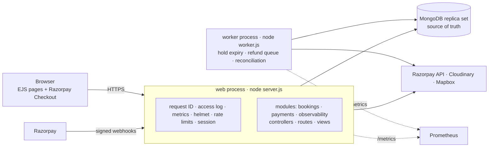
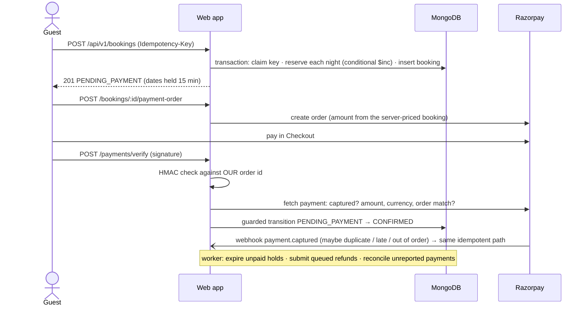
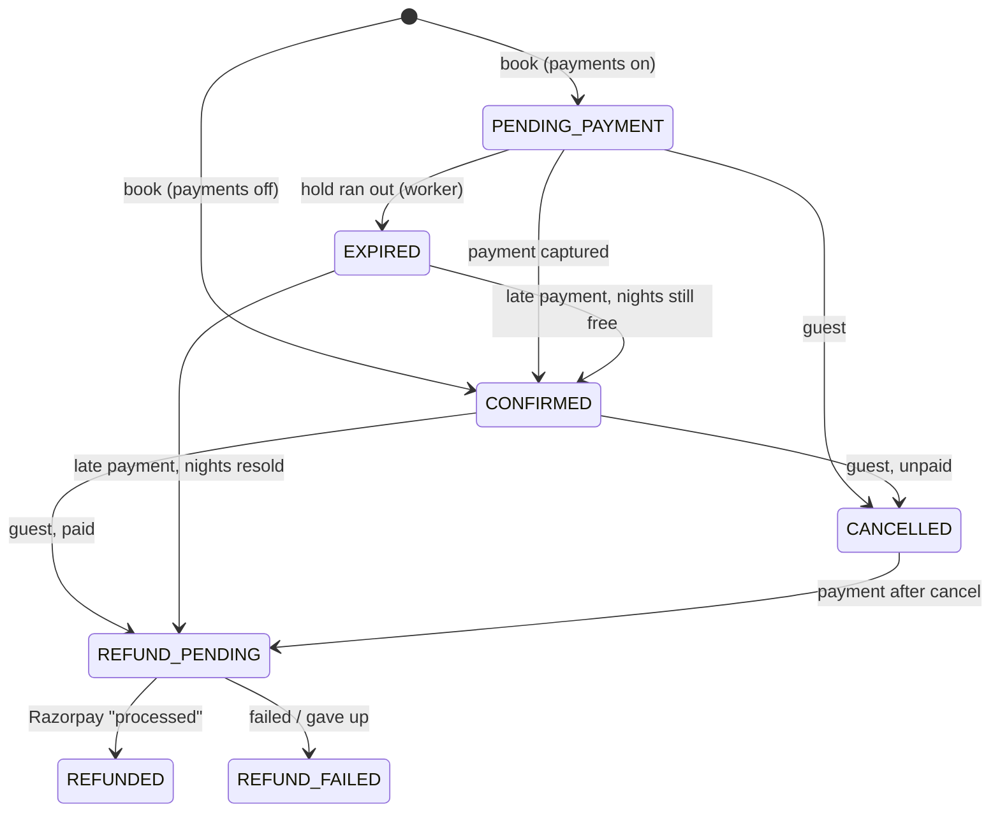
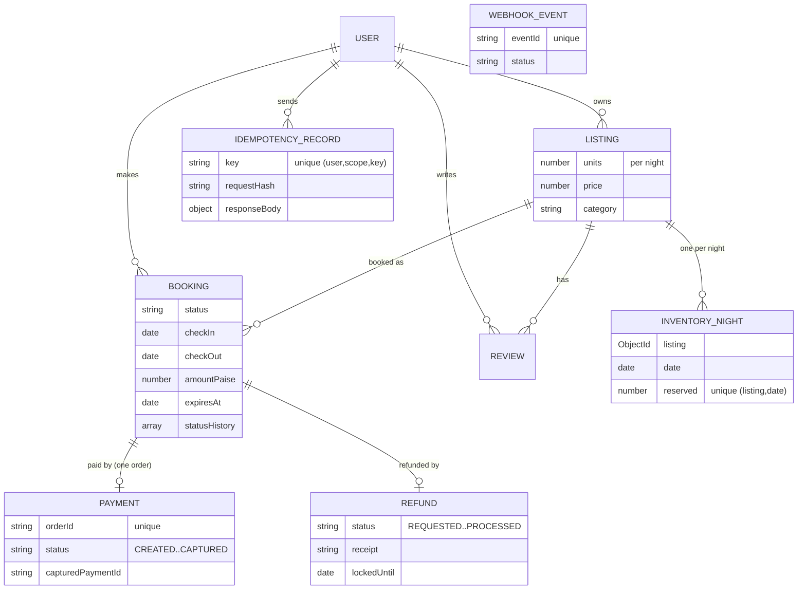

# TravelByChance

[](https://github.com/Mmeghna10/travel-by-chance/actions/workflows/ci.yml)

A travel-stays booking platform (in the style of Airbnb) built with **Node.js, Express 5, EJS and MongoDB**. On top of a working listings marketplace, it focuses on the backend problems real booking systems have:

- **No double booking:** 100 users racing for the last room produce exactly **1** booking and **99** "sold out" answers. Inventory is never negative and never oversold, even under concurrent load.
- **No duplicate bookings or charges** from double clicks, retries or network failures (idempotency keys).
- **Payments that can't lie:** Razorpay (test mode) bookings are confirmed only on server-verified, captured payments. The system handles duplicate, late and out-of-order webhooks, crashes between "paid" and "confirmed", and refunds through a transactional outbox.
- **An explicit booking state machine:** unpaid holds expire automatically, and every transition is guarded and audited.
- **Production practice:** Docker, structured logs with request IDs, Prometheus metrics, load testing, and a GitHub Actions pipeline that tests the real containers on every push.

Everything above is backed by **114 automated tests** against a real MongoDB replica set, including concurrency races and mutation checks (safeguards deliberately broken to prove the tests catch it). How each piece was designed, measured and verified is in [`docs/`](#documentation).

---

## Contents
[Features](#features) · [Architecture](#architecture) · [Booking & payment flow](#booking-and-payment-flow) · [Concurrency strategy](#concurrency-strategy) · [Data model](#data-model) · [Getting started](#getting-started) · [Configuration](#configuration) · [API](#api) · [Testing](#testing) · [Load testing](#load-testing) · [CI/CD & deployment](#cicd-and-deployment) · [Project structure](#project-structure) · [Known limitations](#known-limitations) · [Documentation](#documentation)

## Features

**For guests:** browse 11 categories, search with live suggestions, listing pages with reviews and a Mapbox map, live availability and server-computed prices, booking with a short hold while paying through Razorpay Checkout, "My Bookings" with status, and cancellation (refunded automatically if paid).

**For hosts (admins):** create, edit and delete listings (Cloudinary image upload, automatic geocoding), set how many **units** a listing has per night, and an admin dashboard. Admin accounts are created only from the command line, never through public signup.

**Under the hood:**

| Area | What's implemented |
|---|---|
| Booking correctness | Per-night inventory, atomic conditional updates inside MongoDB transactions, idempotency keys, strict date validation, integer-paise pricing |
| Lifecycle | State machine (`PENDING_PAYMENT → CONFIRMED / EXPIRED / CANCELLED → REFUND_PENDING → REFUNDED`), guarded transitions with an audit trail, expiry worker |
| Payments | Razorpay orders, HMAC-verified checkout + API fetch, signed webhooks (raw body), dedupe, out-of-order handling, refund outbox with leases / retries / dead-letter, reconciliation job |
| Security | Role-based access, object-level authorization (others' bookings return 404), XSS-safe rendering, CSP and security headers, rate limiting, regex/NoSQL-injection-safe queries, secrets only in the environment |
| Observability | pino JSON logs with request IDs and redaction, Prometheus `/metrics` (latency per route, booking/payment/refund outcomes, MongoDB latency and write conflicts), error-reporting hook, health and readiness probes |
| Delivery | Multi-stage Dockerfile (non-root), Docker Compose (MongoDB replica set + app + worker), GitHub Actions CI (lint, tests, audit, Docker smoke test, graceful-shutdown check, image scan), publish to GHCR, deploy-by-digest |

## Architecture

A **modular monolith**: one deployable codebase with clear modules, run as two processes from the same image.



**Why a monolith?** The core correctness tool is a single database transaction that spans the booking, its inventory, the idempotency record and (for refunds) an outbox row. Split into services, that becomes a distributed saga with compensations, which is more failure modes for no benefit at this scale. The modules (`modules/bookings`, `modules/payments`, …) keep the boundaries clean in case a service ever needs splitting out, e.g. payments for compliance reasons.

**Why no Redis or Kafka?** Inventory must live in the database that holds the bookings (a cache can't be the source of truth for money or rooms). Background jobs use MongoDB rows as a durable queue, with leases, retries and a dead-letter state. Redis becomes useful later as a shared rate-limit store once there are several web instances.

## Booking and payment flow



The booking state machine (`modules/bookings/stateMachine.js`):



## Concurrency strategy

| Problem | Solution | Where |
|---|---|---|
| 100 users, last room | One counter document per listing-night; `updateOne({night, reserved < units}, {$inc: 1})` is atomic, so only one request can take the last unit | `modules/bookings/inventory.js` |
| Multi-night stay partly full | All nights + booking in one **transaction**; a full night rolls back the others | `modules/bookings/service.js` |
| Double click / retry / timeout | `Idempotency-Key` claimed by a **unique index** inside the same transaction; repeats get the stored response | `models/idempotencyRecord.js` |
| Expiry vs payment, cancel vs payment | **Guarded transitions** (`updateOne({_id, status: expected})`) in transactions; invalid transitions rejected by a table | `modules/bookings/stateMachine.js` |
| Duplicate / out-of-order webhooks | Event-id log + idempotent handlers + payment status ranks that never go backwards | `modules/payments/webhooks.js`, `service.js` |
| Crash between "paid" and "confirmed" | Reconciliation job asks Razorpay and finishes the job; confirmation is idempotent | `modules/payments/reconcile.js` |
| Refund exactly once | Outbox row written in the same transaction as `REFUND_PENDING`; worker **lease**; receipt lookup before creating (crash recovery) | `modules/payments/refunds.js` |

What proves it (all real runs; details in [docs/03](docs/03-milestone-2-booking-core.md), [docs/04](docs/04-milestone-3-lifecycle.md), [docs/05](docs/05-milestone-4-payments.md)):
- **100 concurrent users, 1 unit → 1 × 201, 99 × 409**; 60 users / 5 units → exactly 5. After every scenario the test checks the database: no night below 0 or above its units, and every counter equals its bookings.
- **The naive approach really fails:** "read the count, then write", without a transaction, sold **4 and 40 bookings for one room** in two runs.
- Races (payment vs expiry, cancel vs payment, duplicate workers and events) are repeated 20× with random timing jitter, and the tests confirm both orderings actually occur.
- **Mutation testing:** each safeguard (status guard, transaction scope, signature checks, refund lease, …) was removed in turn to check that a test catches it. Several first attempts were **missed** (e.g. the refund lease, until the Razorpay simulator got realistic latency), and the tests were strengthened until each one is caught.

## Data model



Money is stored as integer **paise**. Dates are calendar days stored as UTC midnight. Unique indexes are created at startup, before the server accepts traffic.

## Getting started

**Prerequisites:** Node.js 22, a MongoDB **replica set** (MongoDB Atlas, including the free tier, or the bundled Docker setup; a standalone `mongod` can't run transactions), plus Cloudinary and Mapbox accounts for images and maps.

```bash
git clone https://github.com/Mmeghna10/travel-by-chance.git
cd travel-by-chance
npm install
cp .env.example .env      # then fill in ATLASDB_URL, SECRET, MAP_TOKEN, CLOUD_*
npm run dev               # http://localhost:8080
```

Create a host account and seed sample listings (in PowerShell, first run `$env:ADMIN_PASSWORD = "choose-a-password"` instead of the inline variable):
```bash
ADMIN_PASSWORD=choose-a-password npm run create-admin -- --username host1 --email host1@example.com
```
```bash
npm run seed
```
`npm run seed` **replaces all listings** with sample data.

**Or run the whole stack in Docker** (MongoDB replica set + app + worker; uses your `.env` for secrets, not for the database):
```bash
docker compose up --build -d
docker compose ps         # all services "healthy"
```
More Docker commands, dev mode and troubleshooting: [docs/06](docs/06-milestone-5-docker.md).

**Payments:** add Razorpay **test** keys (`RAZORPAY_KEY_ID`, `RAZORPAY_KEY_SECRET`) and bookings switch to "hold, then pay". Without them, bookings confirm instantly. Test cards and webhook setup: [docs/05](docs/05-milestone-4-payments.md#7-sandbox-testing-no-real-money).

## Configuration

All settings are environment variables; see [`.env.example`](.env.example) for the full list with comments. The important ones:

| Variable | Purpose |
|---|---|
| `ATLASDB_URL`, `SECRET` | **Required.** MongoDB URI (replica set) and session secret. The server refuses to start without them |
| `MAP_TOKEN`, `CLOUD_NAME`, `CLOUD_API_KEY`, `CLOUD_API_SECRET` | Maps and image upload |
| `RAZORPAY_KEY_ID`, `RAZORPAY_KEY_SECRET`, `RAZORPAY_WEBHOOK_SECRET` | Payments (test keys only, unless `ALLOW_LIVE_PAYMENTS=true`) |
| `BOOKING_HOLD_MINUTES`, `REQUIRE_PAYMENT` | Hold length (15) and whether bookings wait for payment (defaults to on when keys are set) |
| `HTTPS_ONLY`, `TRUST_PROXY` | Production behind TLS: `true` and `1`. Must be `false` on plain `http://` or login silently fails |
| `RUN_BACKGROUND_JOBS`, `JOB_INTERVAL_SECONDS` | Run expiry/refunds/reconciliation in the web process (default) or in `npm run worker` |
| `METRICS_TOKEN`, `LOG_LEVEL`, `SLOW_QUERY_MS` | Observability |

## API

JSON API under `/api/v1` (the EJS pages use it too):

| Method | Path | Auth | Description |
|---|---|---|---|
| GET | `/api/v1/listings/:id/quote?checkIn=&checkOut=` | public | Price breakdown (paise) and availability |
| POST | `/api/v1/bookings` | user + `Idempotency-Key` | Create a booking: `201`, `409 SOLD_OUT`, `422 IDEMPOTENCY_KEY_REUSED`, `400 INVALID_DATES` |
| GET | `/api/v1/bookings/:id` | owner | Booking status (others get `404`) |
| POST | `/api/v1/bookings/:id/cancel` | owner | Cancel (idempotent) |
| POST | `/api/v1/bookings/:id/payment-order` | owner | Create or reuse the Razorpay order |
| POST | `/api/v1/payments/verify` | user | Verify a Checkout response |
| POST | `/api/v1/webhooks/razorpay` | Razorpay signature | Webhook receiver (raw body) |
| GET | `/healthz`, `/readyz`, `/metrics` | public / public / token | Liveness, readiness (DB), Prometheus |

Errors are JSON `{ success: false, code, message }`. Every response carries `X-Request-Id`. Full contracts: [docs/03 §8](docs/03-milestone-2-booking-core.md#8-api-contract-new), [docs/04 §6](docs/04-milestone-3-lifecycle.md#6-api-and-ui), [docs/05](docs/05-milestone-4-payments.md).

## Testing

```bash
npm test        # 114 tests; starts a real in-memory MongoDB replica set per file
npm run lint    # ESLint
```

| Suite | Covers |
|---|---|
| `concurrency` | 100 users / 1 unit, 60 / 5 units, overlapping ranges, 20 simultaneous same-key requests |
| `bookings`, `lifecycle`, `lifecycleRaces` | pricing, all-or-nothing nights, forced-failure rollback, idempotency, holds, expiry, cancellation, races with jitter, stale-state transitions, crash recovery |
| `payments` + `unit/signatures` | Razorpay simulator with **real HMAC signatures**: forged signatures, underpayment, authorized≠paid, duplicate / out-of-order webhooks, late payments, refund lifecycle, crash recovery, concurrent refund workers, backoff and dead-letter, reconciliation |
| `auth`, `listings`, `observability`, `health` | privilege escalation, XSS, PII, injection, rate limits, cookies, request IDs, log redaction, metrics labels |
| `unit/*` | state machine (all 147 from/to/actor combinations checked against the 10 allowed transitions), pricing, dates, signatures |

## Load testing

`npm run load:baseline` runs the real server in production mode against a MongoDB replica set, then **checks booking correctness in the database** after the load. k6 scripts with correctness thresholds are in `load/k6/` (not yet run; k6 wasn't installed).

Measured on one laptop (i7-12650H; app, database and load generator on the same machine), so treat these as relative baselines, not production capacity:

| Finding | Before | After |
|---|---|---|
| A flash-message bug wrote a MongoDB session for **every anonymous page view** | 103.7 req/s, p95 248 ms | **381.5 req/s, p95 70 ms** (browse, 20 VUs) |
| Burst of 200 simultaneous bookings | p50 ≈ 2.1–3.9 s; a no-contention control was just as slow, so the bottleneck is database throughput (~60–90 transactional bookings/s here), not lock contention | documented next steps |
| Correctness under every load run | no oversold or negative night; last-unit burst sold exactly 1, 3-unit burst exactly 3 | ✅ |

One hypothesis (fail fast on sold-out nights) made no measurable difference, so it was reverted. Full method and numbers: [docs/07](docs/07-milestone-6-observability.md).

## CI/CD and deployment

Every push runs GitHub Actions ([`.github/workflows/ci.yml`](.github/workflows/ci.yml)):

**lint + 114 tests → dependency audit → Docker job** (build the production image, assert non-root and no secrets inside, run the tests inside the container, `compose up --wait`, smoke test, **graceful-shutdown check**, data persistence, Trivy scan) **→ (main only) publish to GHCR → deploy that exact image digest**.

Actions are pinned to commit SHAs, and the workflow token is read-only by default. The deployment plan (Render + MongoDB Atlas, secrets, migrations, health checks, backups, rollback, scaling) is in [docs/08](docs/08-milestone-7-ci-cd.md).

## Project structure

```
├── server.js / worker.js     # process entrypoints (web, background jobs)
├── app.js                    # createApp(): middleware, routes, error handling
├── config/env.js             # configuration from environment variables
├── modules/
│   ├── bookings/             # pricing, dates, inventory, service, stateMachine, lifecycle
│   ├── payments/             # gateway, signatures, service, webhooks, refunds, reconcile
│   ├── observability/        # logger, metrics, db monitoring, error reporting
│   └── jobs/runner.js        # background job scheduler
├── models/                   # User, Listing, Review, Booking, InventoryNight, IdempotencyRecord, Payment, Refund, WebhookEvent
├── controllers/ routes/ views/ public/
├── init/                     # seed, create-admin, booking migration
├── test/                     # 114 tests + Razorpay simulator
├── load/                     # load baseline + k6 scripts
├── ci/smoke.js               # end-to-end smoke test used by CI
├── Dockerfile, compose*.yaml
└── docs/                     # audit, milestone notes, interview prep
```

## Known limitations

- **Razorpay:** tested against a simulator with real signatures, and Checkout loads in the browser, but a **live sandbox payment hasn't been run** (account onboarding needed KYC). See [docs/05](docs/05-milestone-4-payments.md#-pending-live-razorpay-sandbox-check).
- **Not deployed yet:** the pipeline publishes and can deploy, but no production environment exists.
- Full refunds only; no partial-refund policy; no admin screen for `REFUND_FAILED` bookings.
- Changing booking dates isn't supported (cancel and rebook).
- The Content-Security-Policy still allows inline scripts (the views use inline handlers).
- `cloudinary@1` (required by `multer-storage-cloudinary@4`) has a known high advisory; our fixed upload parameters don't reach it, but the dependency should be replaced.
- Rate limiting is per process; several web instances need a shared store (Redis).
- Load numbers come from a single laptop; k6 scripts haven't been run.

## Documentation

| Doc | Topic |
|---|---|
| [01 Audit & architecture](docs/01-audit-and-architecture.md) | What existed, every finding, the plan |
| [02 Safety & tests](docs/02-milestone-1-safety-and-tests.md) | Security fixes, test harness |
| [03 Booking core](docs/03-milestone-2-booking-core.md) | Inventory, transactions, idempotency, pricing |
| [04 Lifecycle](docs/04-milestone-3-lifecycle.md) | State machine, expiry, cancellation, races |
| [05 Payments](docs/05-milestone-4-payments.md) | Razorpay, webhooks, refunds, reconciliation |
| [06 Docker](docs/06-milestone-5-docker.md) | Images, Compose, Windows commands |
| [07 Observability](docs/07-milestone-6-observability.md) | Logs, metrics, load testing and findings |
| [08 CI/CD](docs/08-milestone-7-ci-cd.md) | Pipeline, deployment plan |
| [09 Interview prep](docs/09-interview-prep.md) | How to explain this project |

## License

ISC (as declared in `package.json`).
