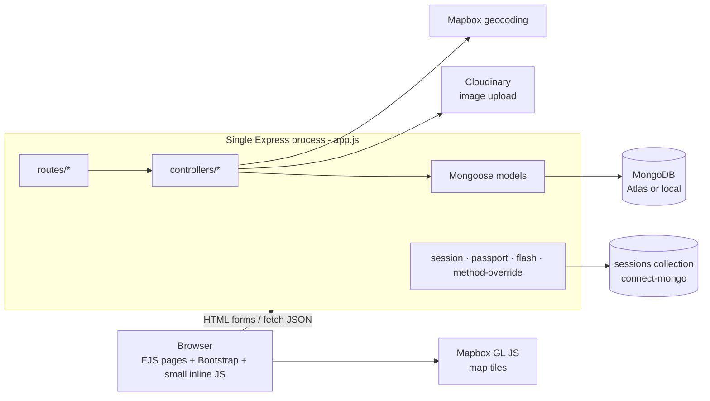
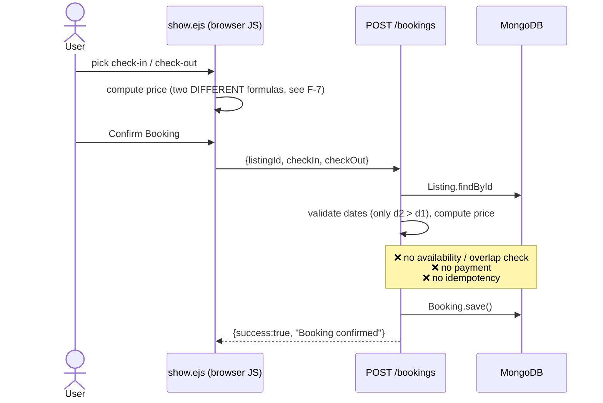
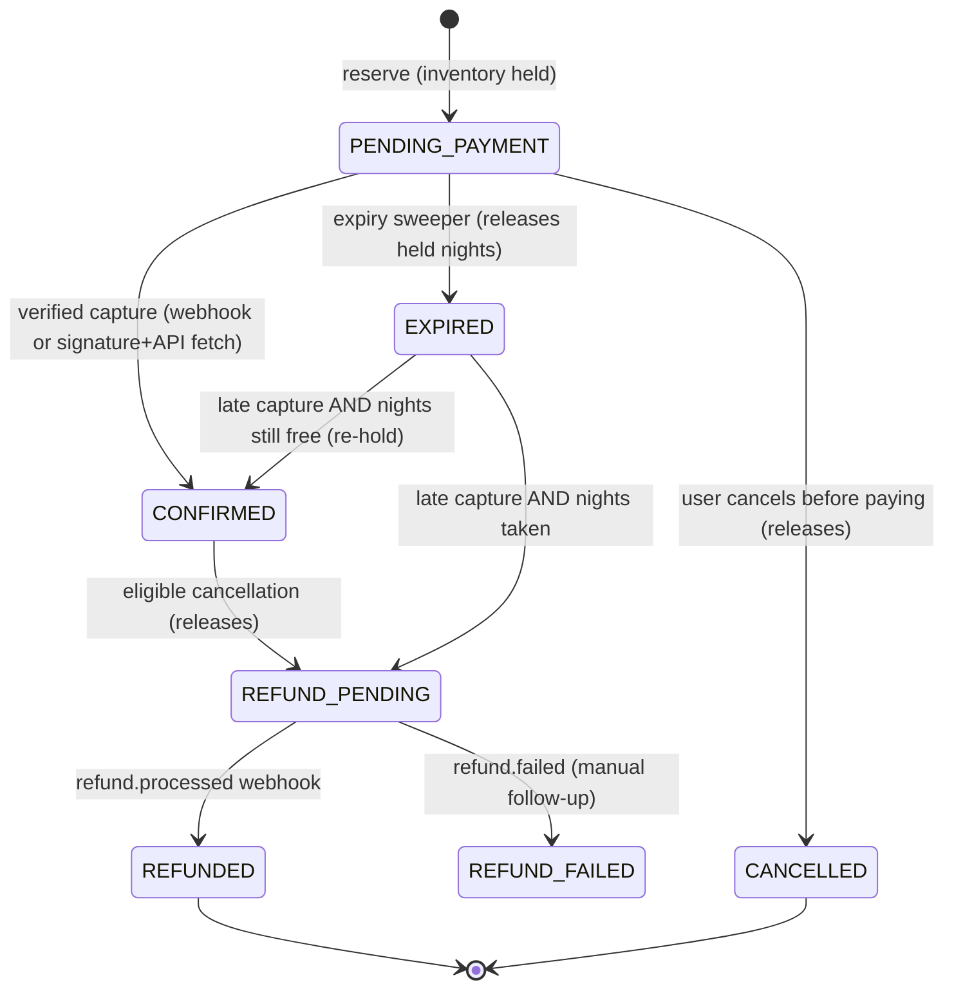
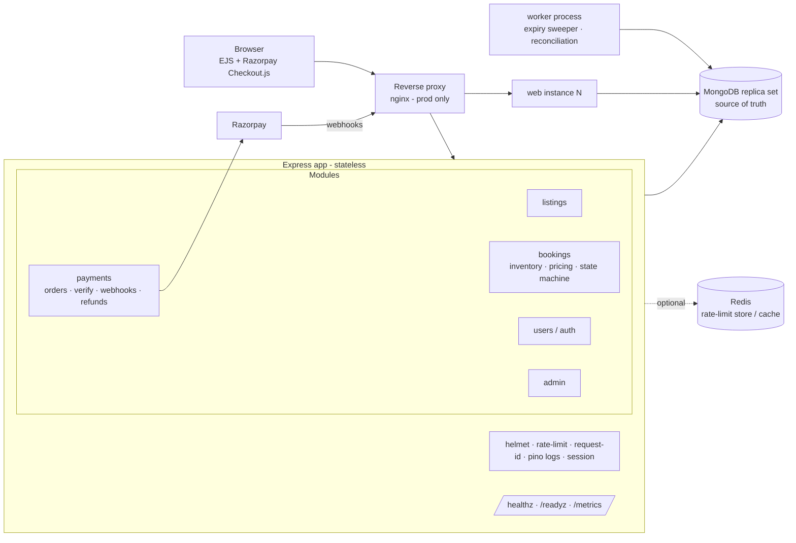

# Milestone 1 — Repository Audit & Architecture Proposal

> Status: audit only. No application code has been changed yet.
> Audited commit: `8a26f45` (branch `main`), 2026-10-21.

---

## 1. What actually exists (verified, not assumed)

| Concern | What the repo really uses | Notes |
|---|---|---|
| Stack | **Node 22 + Express 5 + EJS (server-rendered) + MongoDB/Mongoose 8** | **Not MERN** — there is no React app and no separate frontend. Pages are rendered on the server; the only JSON endpoints are `POST /bookings` and `GET /api/search-suggestions`. |
| Auth | Passport local strategy + `passport-local-mongoose`, `express-session` stored in Mongo (`connect-mongo`) | Session cookie auth, no JWT. Password hash/salt use `select: false` (good). |
| Roles | `customer`, `admin` on `User.role` | Admin = "host" who creates listings. |
| Bookable resource | A **Listing** (a whole stay, Airbnb style) for a **date range** | There is no seat/room/capacity concept. Every listing is implicitly one unit. |
| Payments | **None.** Booking is "confirmed" the moment it is inserted. | |
| Background jobs | None | |
| Tests | None (`npm test` exits with an error). `scratch/` holds manual HTTP scripts that need a running server. | |
| Docker / CI | None. Docker is **not installed** on this machine (`docker: command not found`). | Docker Desktop is needed before the Docker milestone. |
| External services | Cloudinary (images), Mapbox (geocoding + map) | |
| Database | The scratch scripts point to a MongoDB **Atlas** cluster; `.env.example` points to a local standalone `mongod`. | Matters for transactions — see §6. |

### Routes (complete list)

| Method | Path | Guards | Handler |
|---|---|---|---|
| GET | `/` | — | landing (inline in `app.js`) |
| GET | `/listings` | — | `listings.index` (search + category) |
| POST | `/listings` | `isLoggedIn, isAdmin, multer, validateListing` | `listings.createListing` |
| GET | `/listings/new` | `isLoggedIn, isAdmin` | form |
| GET | `/listings/:id` | — | `listings.showListing` |
| PUT | `/listings/:id` | `isLoggedIn, isOwner, validateListing` | `listings.updateListing` |
| DELETE | `/listings/:id` | `isLoggedIn, isOwner` | `listings.destroyListing` |
| GET | `/listings/:id/edit` | `isLoggedIn, isOwner` | form |
| POST | `/listings/:id/reviews` | `isLoggedIn, validateReview` | `review.createReview` |
| DELETE | `/listings/:id/reviews/:reviewId` | `isLoggedIn, isReviewAuthor` | `review.destroyReview` |
| POST | `/bookings` | `isLoggedIn` | `bookings.createBooking` (JSON) |
| GET | `/bookings` | `isLoggedIn` | `bookings.indexBookings` (own bookings only ✅) |
| GET | `/admin` | `isLoggedIn, isAdmin` | `admin.dashboard` |
| GET/POST | `/signup`, `/login`; GET `/logout` | — | `user.*` |
| GET | `/api/search-suggestions` | — | `listings.searchSuggestions` (JSON) |

---

## 2. Current architecture



## 3. Current booking flow



## 4. Current database schema

```mermaid
erDiagram
  USER ||--o{ LISTING : owns
  USER ||--o{ BOOKING : makes
  USER ||--o{ REVIEW : writes
  LISTING ||--o{ REVIEW : "reviews[] (ObjectId array)"
  LISTING ||--o{ BOOKING : "booked as"
  USER { ObjectId _id; string username "unique (plm)"; string email "unique"; string role "customer|admin"; string hash "select:false"; string salt "select:false" }
  LISTING { ObjectId _id; string title; string description; object image; number price; string location; string country; ObjectId owner; GeoJSON geometry; string category; ObjectId[] reviews }
  BOOKING { ObjectId _id; ObjectId listing; ObjectId user; date checkIn; date checkOut; number totalPrice; date createdAt }
  REVIEW { ObjectId _id; string comment; number rating; ObjectId author; date createdAt }
```

**Indexes:** only the unique `email` and `username` on users. No index on `bookings.user`, `bookings.listing`, or `listings.category`; search uses unanchored regex → full collection scan every request.

---

## 5. Findings (technical debt, bugs, security)

Severity: 🔴 critical · 🟠 high · 🟡 medium · ⚪ low. Every item below was verified by reading the code.

### Correctness / concurrency

| # | Sev | Finding | Where |
|---|---|---|---|
| F-1 | 🔴 | **No availability check at all.** Two users (or the same user twice) can book the same listing for overlapping dates. Even if a "find overlapping booking" check were added, doing *check → then insert* in two steps is a race: 100 concurrent requests would all see "free" and all insert. | `controllers/bookings.js:14-39` |
| F-2 | 🔴 | **Booking is confirmed with no payment** and has no status field, so there is no way to model pending / expired / cancelled / refunded. | `models/booking.js` |
| F-3 | 🟠 | **Not idempotent.** Double-click is prevented only by disabling the button in the browser; a retry / refresh / second tab creates a second booking. | `views/listings/show.ejs:363-392` |
| F-4 | 🟠 | **Editing a listing is broken.** The edit form is `multipart/form-data` but `PUT /listings/:id` has no multer middleware, so `req.body` is empty and Joi rejects it with 400 "listing is required". (Also, if it worked, the new image could never be saved and geometry is never re-geocoded.) | `routes/listing.js:33-38`, `views/listings/edit.ejs:15` |
| F-5 | 🟡 | Server accepts past check-in dates, unbounded stay length, and any string as `listingId` (invalid ObjectId → `CastError` → 500 rendered as an **HTML** page to a JSON client). | `controllers/bookings.js`, `app.js:152` |
| F-6 | 🟡 | Deleting a listing leaves its bookings orphaned (views paper over it with `if (booking.listing)`). Once money is involved this needs a refund/cancellation policy. | `models/listing.js:48` |
| F-7 | 🟡 | **Price shown ≠ price charged.** Sidebar and server: `price×nights + 5%·price + 12%·price` (fees charged once on the nightly rate). Modal: `price×nights×1.17`. For 3 nights at ₹1000 the modal says ₹3,510, the server stores ₹3,170. Pricing logic is duplicated in 3 places. | `show.ejs:329-360`, `bookings.js:25-29` |
| F-8 | ⚪ | `Review.createdAt` default is `Date.now()` (called once at boot) instead of `Date.now` → every review gets the server-start time. | `models/review.js:13` |
| F-9 | ⚪ | Session `cookie.expires` is computed once at boot (`maxAge` overrides it, so harmless but misleading). | `app.js:79` |

### Security

| # | Sev | Finding | Where |
|---|---|---|---|
| S-1 | 🔴 | **Privilege escalation: anyone can sign up as admin.** `role` is taken straight from the form body. An admin can then see *every* user's bookings on `/admin`. | `controllers/user.js:9-10`, `views/users/signup.ejs:43` |
| S-2 | 🔴 | **Stored XSS.** `show.ejs` does `<%- JSON.stringify(listing) %>` inside a `<script>`. `JSON.stringify` does not escape `<`, and the listing includes populated review comments. Any logged-in user can post a review containing `</script><script>…</script>` and run JS in every visitor's session. | `views/listings/show.ejs:4` |
| S-3 | 🟠 | **PII leak.** The same JSON blob includes the populated `owner` and every review `author` — their **email addresses** are in the page source for anyone. | `controllers/listings.js:58-63` |
| S-4 | 🟠 | No rate limiting → login brute-force and booking-spam are unlimited. | `routes/user.js` |
| S-5 | 🟠 | User-supplied text is used directly as a regex in search (`$regex: q`) → regex injection / ReDoS and unindexed scans. | `controllers/listings.js:15-20, 149-154` |
| S-6 | 🟠 | 23 npm advisories (1 critical, 17 high) incl. direct deps `express`'s `path-to-regexp`, `mongoose`, `multer`, `joi`, `cloudinary`. Most are fixable with a non-breaking `npm audit fix`. `nodemon` is in `dependencies` instead of `devDependencies`. | `package.json` |
| S-7 | 🟡 | No security headers (no `helmet`), no CSRF token. Modern browsers default cookies to `SameSite=Lax`, which blocks most cross-site POSTs, but this should be explicit (`sameSite`, `secure` in prod). | `app.js:73-83` |
| S-8 | 🟡 | `isOwner` / `isReviewAuthor` / `createReview` crash with `TypeError` when the id doesn't exist (null deref) → 500. | `middleware.js:28-29, 58-59`, `controllers/review.js:7-12` |
| S-9 | ⚪ | `console.log(registeredUser)` on signup; `isLoggedIn` logs every path. Not secrets (hash is `select:false`) but noisy and contains PII. | `controllers/user.js:12`, `middleware.js:7` |

### Reliability / operability

| # | Sev | Finding | Where |
|---|---|---|---|
| R-1 | 🟠 | If MongoDB is unreachable the error is just logged and the server **starts anyway**, serving 500s. | `app.js:39-49` |
| R-2 | 🟠 | Session-store error handler references an undefined `err` → a store error throws `ReferenceError` and can crash the process. | `app.js:68-70` |
| R-3 | 🟡 | DNS is hard-coded to Google (`dns.setServers(['8.8.8.8'])`) — a local network workaround that will break service discovery inside Docker (`mongo` hostname). | `app.js:1-6` |
| R-4 | 🟡 | No health endpoint, no graceful shutdown (SIGTERM), no structured logs, no request IDs. | `app.js` |
| R-5 | 🟡 | `app.js` builds *and* starts the server at import time → cannot be imported by tests. | `app.js:159` |
| R-6 | ⚪ | `logout` calls `next(err)` and then keeps going (double response). | `controllers/user.js:45-50` |
| R-7 | ⚪ | Category-guessing logic is copy-pasted in `init/index.js` and `init/migrate_categories.js`. Admin dashboard loads all listings/bookings with no pagination. | |

### Keep as-is (works and is reasonable)

EJS layouts and the whole UI, Passport session auth, Cloudinary uploads, Mapbox, review feature, Joi validation pattern, `wrapAsync` + `ExpressError`, the "bookings list shows only my bookings" query (`bookings.js:50` — object-level access is correct there).

---

## 6. Key design decision: how to prevent double booking in *this* app

**The resource is not a "seat" — it is a listing-night.** A booking for 12–15 Aug consumes the nights of 12, 13 and 14 Aug. Two bookings conflict if they share any night. To make the classic "100 users, last seat" scenario real, I propose adding `Listing.units` (default `1`): a whole villa has 1 unit, a hostel listing might have 6 beds.

| Approach | Works? | Why / why not here |
|---|---|---|
| Frontend check / disabling the button | ❌ | Only UX. Anyone can call the API directly. |
| `find overlapping bookings` then `insert` | ❌ | Check-then-act race. Two requests both read "free" before either writes. |
| Unique index on `(listing, checkIn)` | ❌ | Doesn't catch *overlaps* (12–15 vs 13–16 have different checkIn). |
| **Per-night inventory docs + atomic conditional `$inc` inside a MongoDB transaction** | ✅ **Recommended** | One `InventoryNight {listing, date, units, held}` per listing-night with a unique index `(listing, date)`. Reserving = for each night `updateOne({listing, date, held: {$lt: units}}, {$inc: {held: 1}})` (upserting the night if it doesn't exist yet). The *filter + update is atomic on one document*, so the last unit can be taken exactly once. The **transaction** makes the multi-night reservation all-or-nothing (if night 3 is full, nights 1–2 are rolled back) and makes the booking insert part of the same commit. |
| Optimistic concurrency (`version` field, retry) | ⚠️ | Works, but the conditional `$inc` is already optimistic in effect and needs no read-then-write. Useful later for *booking edits* (Scenario D). |
| Pessimistic lock | ⚠️ | MongoDB has no `SELECT … FOR UPDATE`; you'd emulate it. Not needed. |
| Redis distributed lock (Redlock) | ❌ for correctness | Locks can expire mid-operation (GC pause, network partition); the database must still be the source of truth. Only justified for coordinating non-DB side effects. |

**Requirement:** MongoDB transactions need a **replica set**. Atlas clusters are replica sets (✅). A plain local `mongod` (your `.env.example`) is **not** — local dev/test will use a single-node replica set (Docker `--replSet rs0`, or `mongodb-memory-server`'s `MongoMemoryReplSet` in tests).

**Idempotency:** client generates an `Idempotency-Key` (UUID) when the booking modal opens. Server stores `IdempotencyRecord {key, user, requestHash, status, response}` with a unique index on `(user, key)` *inside the same transaction*. Same key + same payload → replay stored response. Same key + different payload → `422`. Concurrent duplicates → the unique index lets only one win; the loser returns `409 in progress` or the stored result.

---

## 7. Proposed booking & payment state machines (draft — finalized in Milestone 3/4)

Adjusted to Razorpay's real lifecycle (order `created → attempted → paid`; payment `created → authorized → captured | failed`, `refunded`). We'll enable **auto-capture**, so `authorized` is a short transient state.



Every transition is a **guarded update**: `updateOne({_id, status: <expected from-state>}, {$set: {status: <to>}})`. If `modifiedCount === 0`, someone else already moved it — this is what makes "expiry vs payment" and "cancel vs confirm" races safe, and what makes duplicate webhooks harmless.

---

## 8. Proposed architecture (modular monolith)



- **Same codebase, two entrypoints:** `server.js` (web) and `worker.js` (background). Scale web horizontally; sessions already live in Mongo, so instances are stateless.
- **Background jobs without new infrastructure first:** the expiry sweeper polls `bookings {status: PENDING_PAYMENT, expiresAt < now}` and transitions each with a guarded update. State lives in the DB, so a worker crash loses nothing and duplicate workers are harmless. **BullMQ + Redis** is added only if we need delayed emails/retries with backoff that the DB-poll approach makes awkward — I'll justify it at that point. **No Kafka.**
- **Redis** only for a distributed rate-limit store (needed once there are ≥2 web instances) and maybe listing caching. Never for inventory.
- **Microservices later?** Only if e.g. payments needed independent deploys/compliance scope or a team boundary. Today one DB transaction across booking+inventory+idempotency is the core correctness tool — splitting services would replace it with sagas.
- **Versioned JSON API** `/api/v1/bookings`, `/api/v1/payments/...` alongside the existing EJS pages (pages keep working; the API is what tests and k6 hit).

### Proposed new collections

| Collection | Purpose | Key indexes / invariants |
|---|---|---|
| `inventorynights` | held count per listing-night | unique `(listing, date)`; `held ≤ units` enforced by conditional update |
| `bookings` (extended) | `status, nights, amountPaise, currency, expiresAt, version` | `(user, createdAt)`, `(status, expiresAt)` |
| `idempotencyrecords` | replay protection | unique `(user, key)`; TTL on `createdAt` (24 h) |
| `payments` | Razorpay order/payment per booking | unique `razorpayOrderId`; unique sparse `razorpayPaymentId` |
| `webhookevents` | dedupe deliveries | unique `eventId` (from `x-razorpay-event-id`) |
| `refunds` | refund lifecycle | unique `razorpayRefundId` |
| `outboxevents` | only if/when we send emails/notifications | `(status, createdAt)` |

Money will be stored as **integer paise** (Razorpay's unit), never floats.

---

## 9. Prioritized roadmap

| # | Milestone | Depends on | Complexity |
|---|---|---|---|
| **M1** | **Safety fixes + test harness.** Fix S-1, S-2, S-3, S-5, S-8, F-4, F-8, R-1, R-2, R-6; `helmet`, login rate limit, `npm audit fix` (non-breaking), move nodemon to devDeps; split `app.js` → `createApp()` + `server.js`; `/healthz` `/readyz`; graceful shutdown; test runner (`node:test` + `supertest` + `mongodb-memory-server` replica set) with first tests. | — | M |
| **M2** | **Correct booking core.** `units` on Listing, `InventoryNight`, pricing module (single source → fixes F-7), transactional reservation, booking `status`, server-side validation (F-5), idempotency keys, `/api/v1/bookings`. **Concurrency tests: 100 parallel requests for the last unit, same-key replays, overlapping ranges.** | M1 | L |
| **M3** | **Expiry & cancellation.** `expiresAt`, worker sweeper, guarded transitions, cancel endpoint with ownership checks, race tests (expiry vs confirm, cancel vs confirm), state-transition unit tests. | M2 | M |
| **M4** | **Razorpay (test mode).** Order creation, Checkout.js, signature verify, raw-body webhook verify, event dedupe, out-of-order handling, late-payment policy, refunds, reconciliation job. Sandbox instructions. | M3 | L |
| **M5** | **Docker.** One app image (web + worker commands), multi-stage, non-root, healthchecks, Compose with Mongo single-node replica set + persistent volume, optional Redis. Windows commands. *(Install Docker Desktop first.)* | M1 (better after M4) | M |
| **M6** | **Observability & load.** pino structured logs + request IDs, `prom-client` metrics (booking attempts, conflicts, payment outcomes), k6 baseline with real numbers. | M2, M5 | M |
| **M7** | **CI/CD.** GitHub Actions: `npm ci`, lint, tests (with Mongo replica set), Docker build, `npm audit`/image scan; deployment plan (e.g. Render/Railway + Atlas). | M1, M5 | S–M |
| **M8** | **Docs & interview prep.** README rewrite, API contract, diagrams, interview answers grounded in the code. | all | S |

M1 comes first because S-1 (anyone becomes admin) and S-2 (XSS) are exploitable today, and because every later milestone needs a test harness to prove its claims.

## 10. Files likely to change

**Modified:** `app.js` (→ `createApp`), `package.json`, `.env.example`, `.gitignore`, `middleware.js`, `schema.js`, `models/booking.js`, `models/listing.js`, `models/review.js`, `controllers/bookings.js`, `controllers/listings.js`, `controllers/review.js`, `controllers/user.js`, `controllers/admin.js`, `routes/listing.js`, `routes/bookings.js`, `views/listings/show.ejs`, `views/listings/edit.ejs`, `views/users/signup.ejs`, `views/users/bookings.ejs`, `views/admin/dashboard.ejs`, `init/index.js`, `README.md`.

**New:** `server.js`, `worker.js`, `config/`, `modules/bookings/{inventory,pricing,stateMachine,service}.js`, `modules/payments/{razorpay,webhooks,refunds,reconcile}.js`, `models/{inventoryNight,idempotencyRecord,payment,webhookEvent,refund}.js`, `routes/api/v1/*.js`, `test/**`, `load/booking.k6.js`, `Dockerfile`, `.dockerignore`, `docker-compose.yml`, `.github/workflows/ci.yml`, `docs/*`.

**Removed/replaced:** `scratch/*` (superseded by real tests), the hard-coded DNS override (made opt-in via env var).

---

## 11. Decisions I need from you (defaults in bold)

1. **Keep EJS server-rendered pages (recommended)** vs add a React frontend. The prompt mentions separate frontend/backend Dockerfiles, but there is no frontend app — one image is the honest setup. React adds no backend-engineering signal and doubles the work.
2. **Add `units` per listing, default 1** (enables real "last seat" tests) vs keep strictly one unit per listing.
3. **Admin accounts created only by a seed/CLI script**; remove the "Host" option from public signup (existing admin users keep their role).
