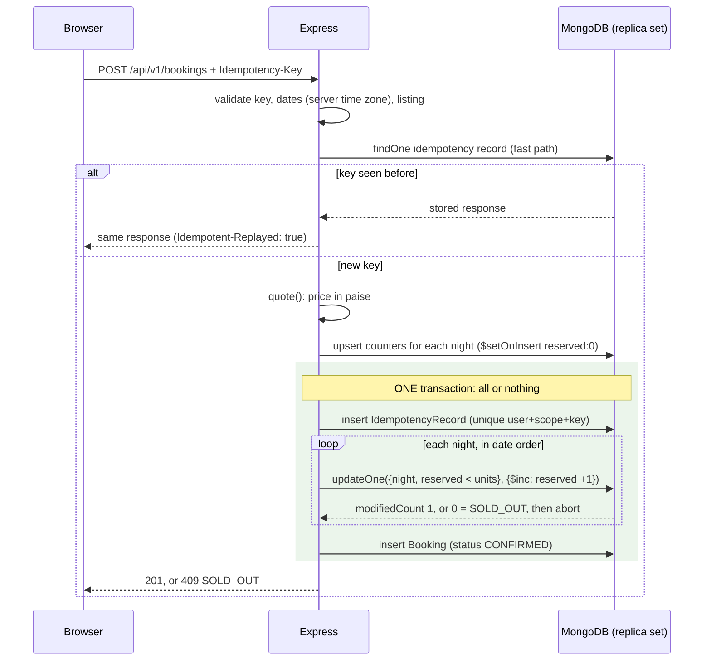

# Milestone 2: Correct booking core

Goal: make double booking impossible, make booking requests safe to retry, and have exactly one place that computes prices. Payment, expiry and cancellation build on this in Milestones 3 and 4.

## 1. The problem, precisely

Before this milestone `POST /bookings` did: find listing → compute price → `insert booking`. It never checked whether the dates were free, so two guests could book the same villa for the same night. A naive fix (`find overlapping bookings`, then `insert` if none) is still wrong. Both requests can run the `find` before either runs `insert`, so both see "free". This is a **check-then-act race**.

I measured it. With the naive approach (read the count, check it in JavaScript, then write, with no transaction), 100 simultaneous requests for **one** unit produced **4 bookings in one run and 40 in another**. It depends on timing, which is exactly why these bugs survive manual testing.

## 2. Modelling the inventory

What's being sold isn't a "booking"; it's a **listing-night**. A stay from 12 → 15 Aug occupies the nights of the 12th, 13th and 14th. The 15th (check-out day) is free for the next guest.

- `Listing.units` (new, default 1): identical units per night. A villa has 1; a hostel dorm might have 6. Existing listings get 1 automatically.
- `InventoryNight { listing, date, reserved }` (new collection): one counter per listing-night, with a **unique index on `(listing, date)`**. The invariant is `0 ≤ reserved ≤ units`.

Why counters instead of searching bookings for overlaps? Every request that wants night *N* has to touch the **same document**, so MongoDB can serialise them. "Find overlapping bookings" reads many documents and writes a different one, and there's nothing for the database to detect a conflict on.

## 3. How a booking is made (`modules/bookings/service.js`)



### What protects which invariant

| Invariant | Mechanism | Why it's needed |
|---|---|---|
| A night is never sold beyond `units` | Conditional update `{reserved: {$lt: units}}` + `$inc`, atomic on one document | The check and the write happen as one operation inside MongoDB; there's no gap to race in |
| A multi-night stay is all-or-nothing | **Transaction** | If night 3 is full, nights 1–2 (already incremented) are rolled back |
| A failure mid-way leaves no partial state | **Transaction** | Crash or DB error after reserving inventory, before inserting the booking: nothing is committed |
| One logical request → at most one booking | **Unique index** on `IdempotencyRecord(user, scope, key)`, written first inside the transaction | Two duplicate requests on different server instances: only one insert can win; the loser replays the winner's response |
| One counter per night | **Unique index** on `InventoryNight(listing, date)` | Otherwise two "first bookers" could each create their own counter |
| The price can't be tampered with | Server-side `quote()`; body fields like `totalPrice` are ignored | The browser is untrusted |

**Does the transaction alone prevent overselling?** Mostly, and the tests showed it. Inside a MongoDB transaction, two transactions writing the **same document** conflict: the second gets a `WriteConflict` error, the driver retries it, and the retry sees the updated counter. Even the naive check-then-act passed when wrapped in a transaction. I kept the conditional update anyway because it's correct on its own (it passed with the transaction removed), simpler to reason about, and doesn't depend on transaction semantics. The transaction is still required for all-or-nothing behaviour across nights and for the idempotency record. With the transaction removed, the rollback tests failed.

### Why counters are created outside the transaction
`ensureNights()` upserts `{reserved: 0}` counters before the transaction starts. If that happened inside the transaction, "this night doesn't exist yet" and "this night is full" would both show up as `modifiedCount: 0`. Two requests creating the same night at once is harmless: the unique index allows one insert, and the duplicate-key error is ignored.

### Why the idempotency record is written first
If it were written last, a duplicate request could fail on inventory ("sold out", because its twin took the unit) before reaching the key check, and the user would see an error for a booking that actually succeeded. Writing the key first means a duplicate always ends up replaying the original result.

### MongoDB transaction requirements
Multi-document transactions require a **replica set** (or sharded cluster). MongoDB Atlas clusters (including the free M0 tier) are replica sets. A plain local `mongod` is not; for local development use Atlas or a single-node replica set (Milestone 5's Docker Compose sets this up). Tests use `mongodb-memory-server`'s `MongoMemoryReplSet`, which is a real `mongod`.
Unique indexes are created explicitly at startup (`ensureIndexes()` in `server.js`). Mongoose's default background index build could otherwise leave a window where the uniqueness guarantee doesn't exist yet.

## 4. Idempotency (Scenario B)

The browser generates a UUID **when the confirmation modal opens** and sends it as the `Idempotency-Key` header. A double click, the browser retrying after a timeout, or the user pressing the button again after a network error all reuse that key. Changing the dates starts a new attempt with a new key.

| Situation | Result |
|---|---|
| Same key, same payload, after success | Stored `201` response replayed, with header `Idempotent-Replayed: true`. No new booking. |
| Same key sent 20× at the same moment | One booking; all 20 responses return the same booking id (tested). |
| Same key, different payload | `422 IDEMPOTENCY_KEY_REUSED`. Silently returning a booking for other dates would be worse. |
| Missing or malformed key | `400 IDEMPOTENCY_KEY_REQUIRED` |
| Previous attempt failed (sold out, validation, crash) | Nothing was stored, so the retry is evaluated fresh. Safe, because the failure had no side effects. |
| Same key used by two different users | Independent (keys are scoped per user). |

Records expire after 24 hours (TTL index). Only successful outcomes are stored. Recording failures would also be valid, but then a "sold out" answer would stick even after inventory frees up.

Side benefit: a custom request header can't be sent cross-site without a CORS preflight, which this app doesn't allow. That gives the booking endpoint CSRF protection on top of `SameSite=Lax` cookies.

## 5. Concepts that often get mixed up

| Concept | Question it answers | Here |
|---|---|---|
| **Thread safety** | Can two threads in one process corrupt shared memory? | Node runs your JS on one thread, so in-memory races are rare. But `await` yields, and other requests run in between, so in-process "check then act" across an `await` is still racy. |
| **Database concurrency control** | Can concurrent transactions or operations violate data invariants? | Atomic conditional updates, transactions (snapshot isolation + write-conflict detection), unique indexes. **This is where booking correctness lives**, because every server instance shares the database. |
| **Distributed coordination** | Do separate processes or machines need to agree on something outside the DB? | Not needed. A Redis lock would add a second source of truth that can expire mid-operation; the database already serialises the conflicting writes. |
| **Idempotency** | Does repeating the same request cause the effect twice? | `Idempotency-Key` + unique index. It's about **duplicates of one request**, not different requests competing. |

## 6. Pricing: one source of truth (fixes audit F-7)

`modules/bookings/pricing.js` computes everything in **integer paise** (Razorpay's unit). The listing page asks `GET /api/v1/listings/:id/quote` whenever dates change and only displays the result. The old page computed prices in two different ways: for 3 nights at ₹1,000 the modal said ₹3,510 while ₹3,170 was charged. Now the sidebar, modal and stored booking all show ₹3,170. I kept the original business rule (both fees are a percentage of one night, charged once per stay) and didn't change it.

## 7. Dates (fixes audit F-5)

- Strict `YYYY-MM-DD`; impossible dates like `2026-02-30` are rejected (JS would silently roll them into March).
- Stored as UTC midnight, so a date string always maps to the same instant regardless of server time zone. Views format with `timeZone: 'UTC'` so dates can't shift by a day.
- "Today" is evaluated in `Asia/Kolkata` (override with `BOOKING_TIMEZONE`). At 01:30 IST it's already tomorrow, even though UTC still says yesterday.
- Limits: check-in not in the past, at most 30 nights, at most 365 days ahead.

## 8. API contract (new)

`GET /api/v1/listings/:id/quote?checkIn=2026-11-10&checkOut=2026-11-13` (public)
```json
{ "success": true, "listingId": "…", "checkIn": "2026-11-10", "checkOut": "2026-11-13",
  "available": true, "unitsLeft": 1,
  "quote": { "currency": "INR", "nightlyPaise": 250000, "nights": 3, "subtotalPaise": 750000,
             "cleaningFeePaise": 12500, "serviceFeePaise": 30000, "totalPaise": 792500 } }
```
`available` is **advisory**: it can be stale a millisecond later. Only the booking call decides.

`POST /api/v1/bookings` (logged in). Header `Idempotency-Key: <8–128 of A-Z a-z 0-9 _ ->`; body `{ "listingId", "checkIn", "checkOut" }`.

| Status | `code` | Meaning |
|---|---|---|
| 201 | — | Created (or replayed: header `Idempotent-Replayed: true`). Body: `booking { id, status, checkIn, checkOut, nights, currency, amountPaise, priceBreakdown }` |
| 400 | `INVALID_DATES`, `IDEMPOTENCY_KEY_REQUIRED` | Bad input; nothing written |
| 401 | `UNAUTHENTICATED` | Not logged in |
| 404 | `LISTING_NOT_FOUND` | |
| 409 | `SOLD_OUT` | At least one night has no units left |
| 422 | `IDEMPOTENCY_KEY_REUSED` | Key reused with a different body |
| 429 | — | Over 20 booking attempts/min for this user |

The old `POST /bookings` was removed (its only caller was the listing page, now updated). `GET /bookings` (the page) is unchanged.

## 9. Other changes
- Booking `status` field (only `CONFIRMED` is used until payments arrive), plus `nights`, `amountPaise`, `currency` and `priceBreakdown`. `totalPrice` (rupees) is kept for the existing views.
- "My Bookings" shows the real status. The admin and booking pages format dates in UTC.
- Listing forms have a **Bookable units** field.
- A listing with upcoming active bookings can't be deleted (audit F-6). Deleting a listing removes its inventory counters.
- Indexes: `bookings(user, createdAt)`, `bookings(listing, checkOut)`.
- Fixed a flaky Milestone 1 test. A short test file could close the database while the session store was still creating its TTL index in the background. Teardown and graceful shutdown now wait for that.

## 10. Existing bookings: action for you

Bookings made before this milestone have no status and no inventory, so new bookings could overlap them. Because the old code never checked overlaps, **your database may already contain double bookings**. Run a dry run first; it changes nothing:

```bash
npm run migrate:bookings
```

It lists how many bookings would be migrated and any **conflicts** (overlaps with an earlier booking). When you're happy with the report:

```bash
npm run migrate:bookings -- --apply
```

The oldest booking keeps its nights; conflicting later ones are left without a status for you to resolve manually. The script is safe to re-run. It runs as one transaction, which is fine for a portfolio-sized database (MongoDB limits a transaction to 60 seconds by default).

## 11. Tests

Actual results (2026-10-21, Windows 11, Node 22.23.2, real `mongod` replica set): **50 tests, 50 passed, 0 failed, on three consecutive full runs** (~60–130 s each; most of the time is starting `mongod` per file and hashing 100+ passwords).

| File | What it proves |
|---|---|
| `test/concurrency.test.js` | **100 users / 1 unit → exactly one 201 and 99 × 409 `SOLD_OUT`**; 60 users / 5 units → exactly 5; 40 overlapping ranges never oversell any night; **same key ×20 at once → one booking, one id**; 10 keys from one user → 1 booking. After every scenario it checks the **database**: `0 ≤ reserved ≤ units` for every night, and each counter equals the number of confirmed bookings covering that night. |
| `test/bookings.test.js` | Price and inventory written correctly; client price ignored; bad input has no side effects; overlap vs back-to-back; **all-or-nothing multi-night**; **forced failure after reserving → full rollback**; replay, 422 on payload mismatch, keys scoped per user; quote endpoint; users see only their own bookings; delete guard; legacy listings default to `units: 1`. |
| `test/migrateLegacy.test.js` | Dry run writes nothing; apply keeps the oldest, reports the overlap, skips past stays, and is re-runnable. |
| `test/unit/pricing-dates.test.js` | The ₹3,170 example, integer paise, invalid input, calendar validation, check-out isn't a night, the IST "today" boundary. |

**Mutation checks** (I broke the code on purpose, ran the tests, then restored the files byte-for-byte):

| Mutation | Result |
|---|---|
| Check-then-act **and** no transaction | Scenario A fails: **4 and 40 bookings** for 1 unit in two runs |
| Check-then-act inside a transaction | Passes (write-conflict detection catches it; see §3) |
| Conditional `$inc` without transaction | Scenario A passes; the all-or-nothing and rollback tests **fail** |

**Browser smoke test** (real server, throwaway DB): picking 3 nights at ₹2,500 showed ₹7,500 + ₹125 + ₹300 = **₹7,925** in both the sidebar and the modal (the old modal formula would have shown ₹8,775). I confirmed via the button while firing a duplicate request with the same key at the same moment: both got 201, and "My Bookings" showed **one** booking with a "confirmed" badge. Afterwards the same and overlapping dates reported unavailable, and a stay starting on the check-out day reported available.

## 12. Known limitations / next
- Under heavy contention for one night, losing transactions retry on `WriteConflict` before failing with `SOLD_OUT`. That's correct, but it adds latency; Milestone 6's load test will measure it.
- Price and `units` are read just before the transaction. An admin changing the price at that exact moment could produce a booking at the old price.
- No cancellation, no expiry, no payment yet (Milestones 3 and 4). Status transitions will become guarded updates (`updateOne({_id, status: from}, {$set: {status: to}})`).

## Files
- **New:** `modules/bookings/{pricing,dates,inventory,service,migrateLegacy}.js`, `models/{inventoryNight,idempotencyRecord}.js`, `routes/api.js`, `init/migrate-bookings.js`, `test/{bookings,concurrency,migrateLegacy}.test.js`, `test/unit/pricing-dates.test.js`.
- **Changed:** `models/{booking,listing}.js`, `controllers/{bookings,listings}.js`, `routes/bookings.js`, `app.js`, `server.js`, `middleware.js`, `schema.js`, `utils/ExpressError.js`, `views/listings/{show,new,edit}.ejs`, `views/users/bookings.ejs`, `views/admin/dashboard.ejs`, `test/helpers.js`, `test/{health,listings}.test.js`, `package.json`, `README.md`.
