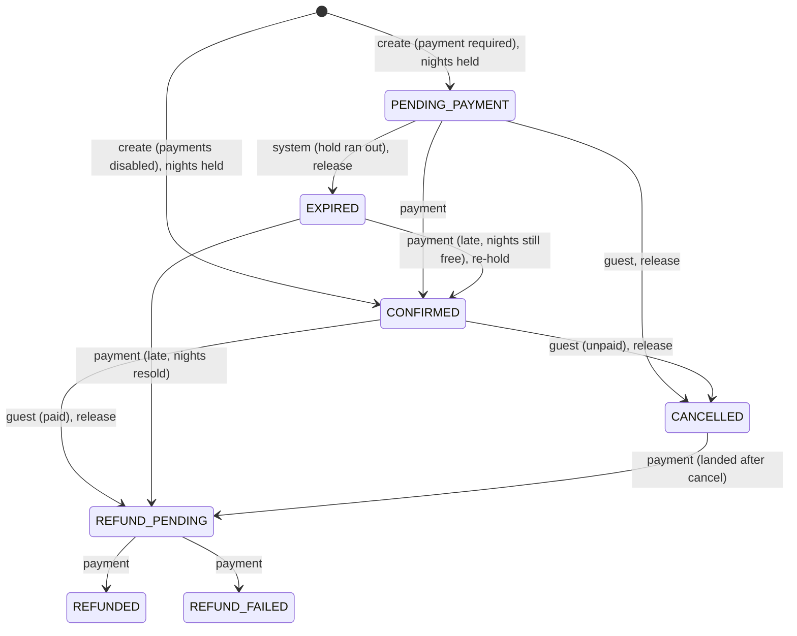

# Milestone 3: Reservation expiry, cancellation and the booking state machine

Goal: give every booking an explicit lifecycle where only valid transitions can happen, even when several actors (guest, expiry worker, payment events) act on the same booking at the same moment. Milestone 4 (Razorpay) plugs into this: a verified payment calls `confirmPayment()`, and a refund outcome moves `REFUND_PENDING` forward.

## 1. States and transitions (`modules/bookings/stateMachine.js`)



| From → To | Actor | Inventory | Why it exists |
|---|---|---|---|
| PENDING_PAYMENT → CONFIRMED | payment | – | Paid while the hold was active |
| PENDING_PAYMENT → EXPIRED | system | release | Unpaid hold ran out |
| PENDING_PAYMENT → CANCELLED | guest | release | Gave up before paying |
| CONFIRMED → CANCELLED | guest | release | Cancel, nothing paid (payments disabled) |
| CONFIRMED → REFUND_PENDING | guest | release | Cancel after paying: money must go back |
| EXPIRED → CONFIRMED | payment | **re-hold** | Late payment, nights still free: honour it |
| EXPIRED → REFUND_PENDING | payment | – | Late payment, nights resold: refund |
| CANCELLED → REFUND_PENDING | payment | – | Payment landed after the guest cancelled |
| REFUND_PENDING → REFUNDED / REFUND_FAILED | payment | – | Provider's refund outcome (Milestone 4) |

**Everything else is invalid**, for example `CONFIRMED → EXPIRED` (expiry must never touch a paid booking), `REFUNDED → anything`, `EXPIRED → CANCELLED`, or a guest moving `PENDING_PAYMENT → CONFIRMED`. A unit test checks all 7 × 7 × 3 = 147 (from, to, actor) combinations against the table.

Inventory effects aren't hand-coded per transition. They're derived: leaving a "holding" state (`PENDING_PAYMENT`, `CONFIRMED`) releases the nights, and entering one reserves them. That rule makes it impossible to add a transition and forget the inventory side.

### Explicit policies
- **Late payment** (paid after the hold expired): re-hold the nights if they're still free and confirm; otherwise `REFUND_PENDING`. The money is real, so we never silently drop it, and we never oversell to honour it.
- **Payment after cancellation:** `REFUND_PENDING`, never resurrecting the booking.
- **Cancellation window:** until the day before check-in (IST). On or after the check-in day: `409 CANCELLATION_CLOSED`. Partial refund rules are a Milestone 4 decision.
- **Repeated cancel:** a no-op that returns `changed: false`, not an error. The user's intent is already satisfied.

## 2. How a transition is applied safely

```js
updateOne(
  { _id, status: from },                                  // guard: only if still in `from`
  { $set: { status: to, ... }, $push: { statusHistory: {from, to, actor, at, reason} } },
  { session })                                            // same transaction as the inventory change
```

Every use-case (`confirmPayment`, `cancelBooking`, `expireStaleHolds`) runs in a MongoDB transaction that:
1. re-reads the booking **inside** the transaction,
2. applies the guarded status update and its audit-trail entry,
3. releases or re-reserves the nights.

Either all three happen or none do.

### What actually protects what (verified by mutation testing)

| Safeguard | What breaks without it | Test that catches it |
|---|---|---|
| Inventory change in the **same transaction** as the status change | A crash between "release night 1" and "release night 2" leaves the booking `PENDING_PAYMENT` with night 1 released: inventory drift | `crash recovery…` (fails when the release is moved outside the transaction) |
| **Guarded update** `{status: from}` | A caller holding a **stale** copy (loaded before a payment landed) could move a CONFIRMED booking to EXPIRED and release its nights | `a transition based on a stale status is refused…` (fails when the guard is removed) |
| **Transaction write-conflict detection** | Concurrent transitions both "win" | All race tests |

An honest finding: when I removed the guard, **the race tests still passed**. Each use-case re-reads the booking inside its transaction, and MongoDB aborts (then retries) the second of two transactions writing the same document, so the retry sees the new status. The transaction is the primary protection against concurrent actors. The guard protects against **stale callers**, which is what will happen in Milestone 4 when a webhook handler works from a booking it loaded earlier. Both are kept, and each has a test that fails without it.

## 3. Expiry worker (`modules/bookings/expiryWorker.js`, `worker.js`)

- Every 30 s (`EXPIRY_INTERVAL_SECONDS`), it finds `PENDING_PAYMENT` bookings with `expiresAt ≤ now` (index `status + expiresAt`), up to 100 per run.
- Each booking is expired in **its own** transaction with the guarded transition, so one bad booking can't block the rest and a crash loses at most one in-flight transaction.
- A `setTimeout` chain (not `setInterval`) means runs never overlap within a process.
- **Duplicate workers are safe:** two workers at once expired 20 holds exactly 20 times in total, with no double release (tested). You can therefore run the worker inside every web instance (default) or as a separate process (`npm run worker` + `RUN_EXPIRY_WORKER=false`).
- **Crash recovery:** the deadline lives in MongoDB, not in the worker's memory. If the worker dies, the next run (or another instance) finds the same rows.
- **Why not BullMQ/Redis?** The job is "find rows past a deadline and move them", and the deadline already lives in the source of truth. A delayed-job queue would add Redis, and a job that fires late or twice would still need the same guarded update. A queue earns its place for retryable side effects that aren't database queries (emails, refunds via an external API), so I'll re-evaluate in Milestone 4.
- **Limitation:** a hold is released up to one interval (≤ 30 s) after it expires. The quote endpoint can briefly show those dates as unavailable.

## 4. Payment confirmation entry point (`confirmPayment`)

Milestone 4's verified-payment and webhook handlers will call this. It's **idempotent**: 20 duplicate calls at once produced exactly one `CONFIRMED` transition and 19 × `ALREADY_CONFIRMED` (tested). Outcomes: `CONFIRMED`, `CONFIRMED_LATE`, `REFUND_REQUIRED`, `ALREADY_CONFIRMED`, `ALREADY_HANDLED`. If a late payment's re-hold hits a sold-out night, that transaction rolls back (including any nights it had already re-reserved) and a second transaction records `EXPIRED → REFUND_PENDING`.

## 5. Payments are still off

`REQUIRE_PAYMENT` defaults to `false`, so bookings are still `CONFIRMED` immediately and cancelling one gives `CANCELLED` with the dates released. With `REQUIRE_PAYMENT=true` today, bookings would hold dates and then expire, because nothing can pay yet. Milestone 4 turns it on.

## 6. API and UI

| Method | Path | Notes |
|---|---|---|
| GET | `/api/v1/bookings/:id` | Owner only; others get **404** (not 403), so ids don't leak existence |
| POST | `/api/v1/bookings/:id/cancel` | `200 {changed, booking}`; `404 BOOKING_NOT_FOUND`; `409 CANCELLATION_CLOSED` / `INVALID_TRANSITION` |
| POST | `/bookings/:id/cancel` | Form on My Bookings; flash message + redirect |

My Bookings shows the real status ("pending payment", "expired", "cancelled", …), a "Held until 13:51 IST" note on pending holds, and a Cancel button (with a confirmation prompt) only where cancelling is allowed. Every booking also stores a `statusHistory` audit trail (`from`, `to`, `actor`, `at`, `reason`), written in the same update as the status change so it can't drift.

## 7. Tests

Actual results (2026-10-21, Windows 11, Node 22.23.2, real `mongod` replica set): **77 tests, 77 passed, 0 failed, on two consecutive full runs.** 27 of them are new in this milestone:

- `test/unit/stateMachine.test.js` (4): all 147 combinations, notable invalid transitions, inventory effects, and every model status present in the table.
- `test/lifecycle.test.js` (17): hold → expiry timing, expiry never touching CONFIRMED, idempotent confirmation, late payment (re-held vs resold → refund), cancel unpaid/paid, payment-after-cancel, cancel with payments disabled, **another user's booking returns 404**, cancellation window, expired can't be cancelled, the page's cancel form, **crash between two night releases → full rollback, next run completes**, **stale-status transition refused**, legacy bookings untouched.
- `test/lifecycleRaces.test.js` (6): each race repeated on 20 fresh bookings, with random 0–8 ms start jitter:

| Race | Invariant asserted every round | Who won (two full runs) |
|---|---|---|
| payment vs expiry | ends `CONFIRMED`, every night held exactly once | payment first 11 and 12 times, expiry first (then re-held) 9 and 8 times |
| cancel vs payment | ends `REFUND_PENDING`, every night released exactly once | cancel first 19/20 both runs; payment first 1/20 both runs |
| two expiry workers | 20 expired in total, no double transitions, no negative counters | – |
| 10 × cancel | one transition, released once | – |
| 20 × duplicate payment | one confirmation | – |
| late payment vs new guest for the freed night | the night is sold exactly once; loser is refunded or rejected | new guest 19/20 both runs |

Without the jitter, cancel won the cancel-vs-payment race **every time (15/15, two runs)** (payment does an extra read first), so the other ordering wasn't being tested. With jitter, both orderings occur, and the payment-first path is also covered deterministically by `guest cancels a paid booking`.

**Mutation checks** (code broken on purpose, then restored byte-for-byte): removing the status guard fails the stale-status test; moving the release outside the transaction fails the crash-recovery test.

**Browser smoke test** (real server, throwaway DB, `REQUIRE_PAYMENT=true`, 12-second hold, worker every 3 s): booking through the page returned `PENDING_PAYMENT` and the dates showed as unavailable. My Bookings showed "pending payment", the hold note, and a Cancel button. I waited 18 s without touching anything: the **in-process worker** expired it (server log: `[expiry] expired 1 unpaid hold(s)`), the status became `EXPIRED`, the dates were available again, and the Cancel button disappeared. On a second hold, posting the cancel form redirected to My Bookings with "Booking cancelled.", the status was `CANCELLED` and the dates were free.

**Worker graceful shutdown:** couldn't be tested on Windows (killing a child process there skips signal handlers). ✅ **Verified later in CI** (Milestone 7, [run 39595562847](https://github.com/Mmeghna10/travel-by-chance/actions/runs/39595562847)): `docker compose stop worker` logged `SIGTERM received, stopping worker` and the container exited with code 0.

## 8. Limitations / next
- Changing a booking's dates isn't supported (cancel and rebook). Doing it safely means "release old nights + reserve new nights + update booking" in one transaction, the same pattern as above.
- Admin-initiated cancellation and a refund-retry path for `REFUND_FAILED` are left for Milestone 4, together with the refund API.
- Hold release latency is up to one sweep interval.

## Files
- **New:** `modules/bookings/{stateMachine,lifecycle,expiryWorker}.js`, `worker.js`, `docs/04-milestone-3-lifecycle.md`, `test/{lifecycle,lifecycleRaces}.test.js`, `test/unit/stateMachine.test.js`.
- **Changed:** `models/booking.js` (`expiresAt`, `paidAt`, `cancelledAt`, `statusHistory`, index `status+expiresAt`), `modules/bookings/service.js` (pending holds), `controllers/{bookings,listings}.js`, `routes/{api,bookings}.js`, `app.js`, `server.js`, `config/env.js`, `views/users/bookings.ejs`, `views/listings/show.ejs`, `test/helpers.js`, `package.json`, `.env.example`, `README.md`.
