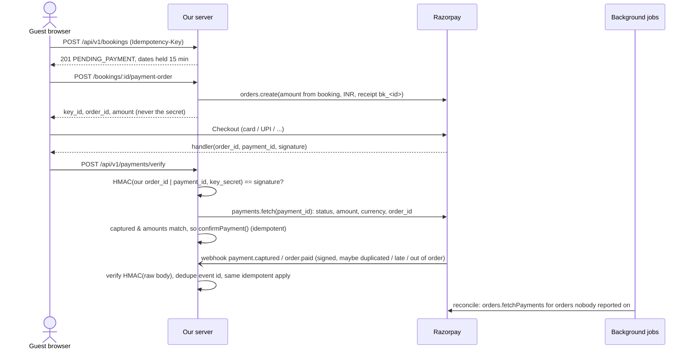

# Milestone 4: Razorpay payments (test mode)

Goal: take payment for a held booking through Razorpay, and confirm a booking **only** on trusted, server-side evidence that the money was captured. That has to hold even when the browser lies or disappears, webhooks are duplicated, late or out of order, or our own process crashes halfway.

Everything was built against Razorpay's official docs and Node SDK (`razorpay@2.9.8`), checked during the milestone: [integration steps](https://razorpay.com/docs/payments/payment-gateway/web-integration/standard/integration-steps/), [webhook validation](https://razorpay.com/docs/webhooks/validate-test/), [payment events](https://razorpay.com/docs/webhooks/payments/), [refund events](https://razorpay.com/docs/webhooks/refunds/), [payment states](https://razorpay.com/docs/payments/payments/), [SDK docs](https://github.com/razorpay/razorpay-node).

## 1. Concepts: order, authorization, capture, settlement, refund

| Step | What it means at Razorpay | What our app does |
|---|---|---|
| **Order** | Our server creates an order for an exact amount (`POST /orders`). Payments made without an order are auto-refunded. Order status: `created → attempted → paid`. | One order per booking, created by the server with the booking's server-computed amount. Repeated "Pay" clicks reuse it. |
| **Authorization** | The bank approved and debited the customer, but the merchant doesn't have the money yet. Uncaptured payments are **auto-refunded after 3 days**. | `Payment.status = AUTHORIZED`. **Not enough** to confirm a booking. |
| **Capture** | Razorpay marks the payment complete; it will settle to us. With the Orders API, auto-capture can be enabled in the Dashboard (recommended). | `CAPTURED` is the only state that confirms a booking. |
| **Settlement** | Captured money moves to our bank account on the account's settlement schedule. | Not modelled; it's accounting, not booking state. |
| **Refund** | Money goes back. A refund can stay unresolved for a while and can fail; it's final only when `processed`. Normal refunds take 5–7 working days to reach the customer. | Queued via an outbox; booking `REFUNDED` only when Razorpay says `processed`. |

## 2. Flow



Three independent paths (**browser verify**, **webhook**, **reconciliation**) all funnel into one function, `applyGatewayPayment()`. Whichever arrives first does the work; the others are no-ops.

## 3. Payment consistency rules and where they're enforced

| Rule | How | Test |
|---|---|---|
| Never trust the browser's "success" | `verify` checks the HMAC signature **and** fetches the payment from Razorpay; only `captured` confirms | `a forged or mismatched checkout signature…`, `authorized-but-not-captured is not enough…` |
| Signature uses **our** stored order id | `verifyCheckoutSignature({ orderId: payment.orderId, ... })`, not the client's copy | forged-signature test (signature for another payment) |
| Validate amount, currency, order id | `applyGatewayPayment` refuses mismatches and records an anomaly | `a valid signature for a payment with the wrong amount…` |
| Webhook authenticity | HMAC-SHA256 over the **raw bytes**, constant-time compare; route mounted before `express.json()` | `webhooks with a bad signature or re-serialised body…` |
| Duplicate webhooks | Event log keyed by `x-razorpay-event-id` + idempotent handlers | `the same webhook delivered twice, and ten times at once…` |
| Out-of-order webhooks | Payment status ranks never go down (`FAILED` can't override `AUTHORIZED`/`CAPTURED`) | `out-of-order events never move a payment backwards` |
| Payment after the hold expired | Explicit policy: re-hold if free → `CONFIRMED`; if resold → `REFUND_PENDING` + refund queued | `late payment after expiry…` |
| Payment after cancellation | `CANCELLED → REFUND_PENDING` + refund queued | Milestone 3 tests + outbox |
| Don't claim a refund succeeded early | Booking `REFUNDED` only on Razorpay `processed` (webhook or API) | `cancelling a paid booking: REFUNDED only once Razorpay confirms…` |
| No double refunds | Refund lease (one submitter) + receipt lookup before creating (crash recovery) + one refund row per booking (unique index) | `two refund workers…`, `refund crash recovery…` |
| One order per booking | Unique `Payment.booking` claim; 10 concurrent clicks → 1 Razorpay order | `ten simultaneous 'Pay' clicks…` |
| Secrets stay server-side | Only `key_id` reaches the browser; `rzp_live_` keys refused unless `ALLOW_LIVE_PAYMENTS=true` | order test checks the secret isn't in the response; unit test for live keys |
| No card data stored | Checkout runs in Razorpay's iframe; we only store ids, amounts and statuses | by design |

### Why I don't call the SDK's signature helpers directly
`razorpay/dist/utils/razorpay-utils` has `validatePaymentVerification` and `validateWebhookSignature`, and I tested them. Both compare signatures with `===`, which returns as soon as a character differs. I implemented the documented algorithm with `crypto.timingSafeEqual` instead. `test/unit/signatures.test.js` checks that we agree with the SDK on 1,000 valid and tampered inputs.

## 4. Payment record states

Ranks only go up (`CREATING 0 → CREATED/FAILED 1 → AUTHORIZED 2 → CAPTURED 3`):

| Payment status | Meaning | Comes from |
|---|---|---|
| `CREATING` | A request has claimed the booking and is calling `orders.create` | first "Pay" click |
| `CREATED` | Order exists, nothing paid | order created |
| `FAILED` | Last attempt failed; **the guest can retry on the same order** | `payment.failed` |
| `AUTHORIZED` | Bank approved; waiting for capture | `payment.authorized` / API |
| `CAPTURED` | Money captured; booking confirmed (or refunded, per policy) | `payment.captured` / `order.paid` / API |

If `orders.create` fails, the claim is released immediately so the guest can retry. A claim left behind by a crashed request is taken over after 30 s.

## 5. Refunds: transactional outbox

When a booking enters `REFUND_PENDING` (paid cancellation, late payment for resold nights, payment after cancellation), a `Refund` row is inserted **in the same transaction** (`stateMachine.applyTransition`). So "needs a refund" can't be committed without the refund being queued, and a crash between the two steps can't lose a refund.

The refund worker (`modules/payments/refunds.js`):
1. **Claims** a due row atomically (`REQUESTED → SUBMITTING`) with a 2-minute **lease**. A crashed worker's lease expires and the row is picked up again.
2. **Looks for an existing refund with our receipt** (`rf_<bookingId>`) on the payment before creating one. If we crashed after Razorpay refunded but before we saved the result, we adopt that refund instead of refunding twice.
3. Calls `payments.refund(paymentId, { amount, speed: "normal", receipt, notes })`.
4. On an error, puts the row back with **exponential backoff** (30 s, 1 m, 2 m, … capped at 1 h). After 6 attempts it's **dead-lettered**: Refund `FAILED`, booking `REFUND_FAILED`, needing a human.
5. Outcome: `processed` → booking `REFUNDED`; `failed` → `REFUND_FAILED`; anything else → `PENDING`, waiting for the `refund.processed` webhook or reconciliation.

Mutation testing showed why steps 1 and 2 are **both** needed. With realistic API latency, "look for an existing refund, then create one" is itself a check-then-act race against Razorpay: two workers can both look, both see nothing, and both refund. The lease prevents concurrent submitters; the receipt lookup handles the crash case. Without the lease, three workers created duplicate refunds.

**Policy:** cancellation before the check-in day gets a full refund. Partial refunds or cancellation fees aren't modelled.

## 6. Background jobs (`modules/jobs/runner.js`)

Every 30 s (`JOB_INTERVAL_SECONDS`), run in-process by default or via `npm run worker`:
- **expiry**: release unpaid holds (Milestone 3)
- **refunds**: submit queued refunds (outbox consumer)
- **reconcile**: for unconfirmed orders quiet for ≥ 1 minute (and younger than Razorpay's 3-day auto-refund window), call `orders.fetchPayments`. Also confirms bookings whose payment we recorded as captured but never confirmed (crash recovery), and polls unresolved refunds.

**Delivery semantics:** webhooks and our own jobs are **at-least-once**: anything can run twice. That's why every consumer is idempotent (guarded state changes, unique indexes, leases) instead of hoping for exactly-once delivery.

**BullMQ/Redis was evaluated and not added.** Every job is "find rows in MongoDB that need attention". The rows already are a durable queue in the source of truth, with retry/backoff and a dead-letter state on the rows themselves. A broker would add infrastructure without removing any of that logic. It becomes worthwhile when there's high-volume work that isn't naturally a query (e.g. bulk emails), or when jobs need sub-second scheduling.

## 7. Sandbox testing (no real money)

1. Create a Razorpay account, switch the Dashboard to **Test Mode**, and generate **test API keys** (they start with `rzp_test_`).
2. Add them to `.env`:
   ```
   RAZORPAY_KEY_ID=rzp_test_...
   RAZORPAY_KEY_SECRET=...
   ```
   With keys set, `REQUIRE_PAYMENT` defaults to on. Startup logs `payments: Razorpay (test mode)`.
3. Check the Dashboard's payment **capture setting is automatic**. With manual capture, payments stay `authorized`, our app (correctly) won't confirm them, and Razorpay auto-refunds them after 3 days.
4. `npm run dev`, log in as a customer, pick dates, and **Continue to payment**. Test values from [Razorpay's test card page](https://razorpay.com/docs/payments/payments/test-card-details/):
   - Success: Visa `4100 2800 0000 1007`, any future expiry, any CVV, OTP of 4–10 digits.
   - Failure: e.g. `4100 2800 0006 0003` (`card_declined`), choosing **Failure** on the test screen, or an OTP shorter than 4 digits. Checkout lets you retry with another card on the same order.
5. **Webhooks (optional locally).** Razorpay can't reach `localhost`. Without webhooks, the verify call plus the reconciliation job (within about 1–2 minutes) still confirm everything. To test them, expose the app through a tunnel (e.g. `ngrok http 8080`) and add a webhook in the Dashboard:
   - URL `https://<tunnel>/api/v1/webhooks/razorpay`
   - a secret, copied into `RAZORPAY_WEBHOOK_SECRET`
   - events `payment.authorized`, `payment.captured`, `payment.failed`, `order.paid`, `refund.processed`, `refund.failed`
6. **Refund:** cancel the paid booking from My Bookings → `REFUND_PENDING`; within one job interval → `REFUNDED` (or it waits for Razorpay to process).

## 8. Tests

Actual results (2026-10-21, Windows 11, Node 22.23.2, real `mongod` replica set): **102/102 on two consecutive full runs, then 103/103 on a final full run after adding the gateway-error regression test** (see the browser check below). 26 are new:

- `test/unit/signatures.test.js` (4): agreement with the SDK on 1,000 cases, raw-bytes requirement, malformed signatures, live-key guard.
- `test/payments.test.js` (22): order creation and reuse; 10 concurrent clicks → 1 order; access control; gateway error → 502 with the claim released; happy path; forged signatures; underpayment; authorized ≠ paid; webhook authenticity; duplicate and concurrent webhooks; out-of-order events; fail-then-retry; unknown orders; late payment (free vs resold); refund lifecycle (pending → processed via webhook); refund crash recovery; concurrent refund workers; backoff and dead-letter; `refund.failed`; three reconciliation scenarios.

Razorpay is replaced by `test/fakeRazorpay.js`, an in-memory simulator implementing the same gateway interface. **Signatures are real HMACs with real secrets**; only the network is simulated, including configurable latency, failures, and "refund created but response lost".

**Mutation checks** (each safeguard removed in turn, the payment tests run, and the file restored byte-for-byte):

| Safeguard removed | Caught by |
|---|---|
| webhook signature check | bad-signature / re-serialised-body test |
| checkout signature check | forged-signature test |
| amount/currency/order check | wrong-amount test |
| treating `authorized` as paid | authorized-not-enough test |
| never-move-backwards guard | out-of-order test |
| receipt lookup before refund | refund crash-recovery test |
| refund lease | two-workers test (**only after adding simulated API latency**; first run: missed) |
| REFUNDED before Razorpay confirms | refund lifecycle + `refund.failed` tests |
| one-order-per-booking claim | order reuse + concurrent clicks + retry tests |

Two harness lessons from this milestone:
- My first webhook tests failed because **supertest JSON-encodes a Buffer body** (`{"type":"Buffer","data":[…]}`). The server correctly rejected it, which is the raw-body requirement in action.
- A simulator that answers instantly hides races. With 40 ms of simulated latency, the missing-lease bug appeared.

**Browser check** (real server, throwaway DB, placeholder test keys). This found two bugs the simulator couldn't, both fixed and re-checked:
1. **CSP blocked Razorpay's risk-detection script** (`cdn.razorpay.com`). Added to `script-src`/`connect-src`; after the fix, Checkout's iframe loads with no CSP violations.
2. **Razorpay's 401 leaked through as our HTTP 401** (which the client reads as "not logged in"), and the failed attempt kept the order claim locked for 30 s. Now the error handler only trusts status codes from our own errors and Express client errors, gateway failures become `502 PAYMENT_PROVIDER_ERROR` (details logged, not shown), and the claim is released so a retry works immediately. A regression test covers it.

### ⏳ Pending: live Razorpay sandbox check

**Status (2026-10-21): not run.** Getting test API keys was blocked: the new Razorpay account was held in onboarding, which requires a personal PAN (KYC) before the Dashboard and its test keys become available, and I chose not to submit KYC for a portfolio project.

What this means:
- **Verified:** everything on our side of Razorpay's API, through the simulator (real HMAC signatures, injected failures, simulated latency, lost responses), and in the browser: Razorpay's real `checkout.js` loads, its Checkout iframe opens under our CSP, and a gateway error surfaces as a 502.
- **Not verified:** a real test-mode payment captured by Razorpay, a real webhook delivery, and a real refund. The response and webhook payload shapes the code relies on come from Razorpay's documentation, not from observed traffic.
- **To close this:** obtain test keys (§7 steps 1–3), then run a test-card payment, a failed payment and retry, and a cancellation → refund, and record the results here.

## 9. Known limitations
- Full refunds only; no partial-refund or cancellation-fee policy.
- `REFUND_FAILED` and payment anomalies (wrong amount, second capture on one order) are recorded and logged, but there's no admin screen or alerting yet (Milestone 6 adds metrics).
- Webhooks need a public URL; locally, rely on reconciliation (≈1–2 min delay).
- Changing the webhook secret: Razorpay retries older events signed with the **old** secret, so rotate with care.

## Files
- **New:** `models/{payment,refund,webhookEvent}.js`, `modules/payments/{gateway,signatures,service,webhooks,refunds,reconcile}.js`, `modules/jobs/runner.js` (replaces `modules/bookings/expiryWorker.js`), `controllers/payments.js`, `public/js/payments.js`, `test/fakeRazorpay.js`, `test/payments.test.js`, `test/unit/signatures.test.js`.
- **Changed:** `app.js` (raw webhook route, CSP, error status handling, `paymentsEnabled` local), `server.js` / `worker.js` (payment config, job runner), `config/env.js`, `modules/bookings/stateMachine.js` (refund outbox), `modules/bookings/service.js` (indexes), `routes/api.js`, `views/listings/show.ejs`, `views/users/bookings.ejs`, `package.json` (`razorpay`), `.env.example`, `README.md`.
