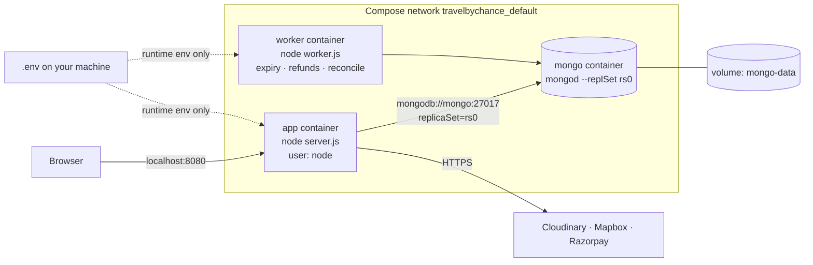

# Milestone 5: Docker, Docker Compose and local infrastructure

Goal: one command starts the whole system (database, web app, background worker) the same way on any machine, without baking secrets into images and with graceful shutdown and health checks.

> **✅ Status: verified in Docker on GitHub Actions** (Linux runner with kernel 7.0, [run 39624260695](https://github.com/Mmeghna10/travel-by-chance/actions/runs/39624260695)); see §9. Docker isn't installed on the development laptop, so local-only parts (dev mode with live reload, MongoDB Compass access) are still untested.

## 1. Concepts in one table

| Term | What it is | In this project |
|---|---|---|
| **Image** | A read-only, layered snapshot of a filesystem plus a start command. Built from a `Dockerfile`. | `travelbychance-app` (from the `prod` stage). Contains Node, production `node_modules` and the source. **No secrets.** |
| **Container** | A running (or stopped) instance of an image, with its own process space and writable layer. Disposable. | `app`, `worker` and `mongo` containers. Delete them anytime; nothing important lives inside. |
| **Volume** | Storage managed by Docker that lives **outside** any container and survives rebuilds and restarts. | `mongo-data` → `/data/db`. Your database survives `docker compose down` and is deleted only by `down -v`. |
| **Network** | A private virtual network; containers on it reach each other **by service name** via Docker's DNS. | Compose creates `travelbychance_default`; the app connects to `mongodb://mongo:27017`. |
| **Compose service** | A named container definition in `compose.yaml` (image or build, env, ports, health check, dependencies). Can be scaled to several containers. | `mongo`, `app`, `worker`. |

## 2. What's in the box



### Dockerfile (multi-stage)

| Stage | Purpose |
|---|---|
| `base` | Pinned `node:22.23.3-bookworm-slim` (same major version as `package.json` engines) |
| `deps` | `npm ci --omit=dev`. The lockfile is copied first, so this slow layer is cached until dependencies change, not on every code edit |
| `dev` | All dependencies plus `nodemon --legacy-watch` (file events don't cross from Windows into Linux containers, so it polls) |
| `test` | `dev` plus a mongod binary pre-downloaded at build time; `CMD npm test` (used by CI in Milestone 7) |
| `prod` | Production deps + source; runs as the **non-root `node` user**; `HEALTHCHECK` on `/healthz` using Node's built-in `fetch` (slim images have no curl); exec-form `CMD ["node", "server.js"]` so Node receives `SIGTERM` |

**Why Debian slim, not Alpine?** MongoDB publishes no binaries for Alpine's musl libc, and the `test` stage runs a real `mongod`. One base for every stage keeps dev, test and prod identical.

### Compose (`compose.yaml`)

- **mongo**: `mongo:7.0.45-jammy` (originally 8.0.34: MongoDB 8.0 and later refuse to start on Linux kernel 6.19+; see §9), started with `--replSet rs0`. **Transactions need a replica set**, even a single-node one; that's what every booking uses. Its health check also runs `rs.initiate(...)` the first time, so "healthy" means "accepting connections **and** replica set ready". Published only on `127.0.0.1:27017`, for MongoDB Compass (`mongodb://localhost:27017/?directConnection=true`).
- **app**: built from the `prod` target. Starts only after mongo is healthy (`depends_on: condition: service_healthy`, which handles dependency readiness). `init: true` adds tini as PID 1 to forward signals and reap zombie processes. `stop_grace_period: 15s` covers server.js's 10-second drain.
- **worker**: same image target, `command: node worker.js`. Web containers run with `RUN_BACKGROUND_JOBS=false`, so the jobs run in one place. Running them in several places would also be safe (Milestones 3–4), just wasteful.
- **Secrets** come from your `.env` **at runtime** (`env_file`). `.dockerignore` excludes `.env`, so they can never end up in an image layer. `SECRET` uses `${SECRET:?…}`, so a missing secret stops `docker compose up` with a clear message instead of a crash loop.
- **Redis: not added.** Nothing needs it yet. Inventory consistency lives in MongoDB on purpose, and background jobs use MongoDB rows as their queue (Milestone 4). It becomes worthwhile for a **shared rate-limit store** once there are several app replicas. Until then it would just be another container to explain.

### A bug found while writing this: `NODE_ENV=production` broke login over HTTP

The app used `NODE_ENV=production` to mean "mark session cookies `Secure` and send `upgrade-insecure-requests`". In a container at `http://localhost:8080` (no TLS), express-session **refuses to set a Secure cookie on a non-HTTPS request**. So signup and login would have "worked" but never logged anyone in, with no error.

Fix: a separate `HTTPS_ONLY` setting (defaults to `NODE_ENV === production`); `compose.yaml` sets `HTTPS_ONLY=false`. In real production behind a TLS-terminating proxy, use `HTTPS_ONLY=true` + `TRUST_PROXY=1`. A test (`HTTPS-only mode: Secure cookie…` in `test/auth.test.js`) covers all three cases: plain HTTP, HTTPS-only over HTTP (no cookie, i.e. the bug), and behind a TLS proxy (Secure cookie).

### Dev mode (`compose.dev.yaml`)
Builds the `dev` target, bind-mounts your source (`.:/app`) and keeps the container's own Linux `node_modules` in an anonymous volume, so the Windows one isn't used. The worker is left out because the dev app runs the jobs itself.

## 3. Install Docker on Windows (one time)

1. **Enable WSL 2.** Open **PowerShell as Administrator** and run the command below, then **restart** the PC:
   ```powershell
   wsl --install
   ```
2. Download **Docker Desktop for Windows** from docker.com, install it with the **"Use WSL 2"** option, and start it. Wait until the whale icon says *Engine running*.
3. Check in a normal PowerShell window:
   ```powershell
   docker --version
   docker compose version
   docker run --rm hello-world
   ```

## 4. Commands (PowerShell, in the project folder)

**Before the first run**, make sure `.env` has at least `SECRET` (plus `MAP_TOKEN` and the `CLOUD_*` keys for maps and image upload). `ATLASDB_URL` in `.env` is **ignored** by Compose: containers always use the local `mongo` service. Your Atlas data is untouched.

| Goal | Command |
|---|---|
| Build images and start everything (detached) | `docker compose up --build -d` |
| Status + health of each service | `docker compose ps` |
| Follow app logs | `docker compose logs -f app` |
| Logs of all services, last 100 lines | `docker compose logs --tail 100` |
| Open the app | http://localhost:8080 |
| Health endpoints | `curl.exe http://localhost:8080/healthz` and `curl.exe http://localhost:8080/readyz` |
| Create an admin inside the container | `docker compose exec -e ADMIN_PASSWORD=choose-a-password app node init/create-admin.js --username host1 --email host1@example.com` |
| Seed sample listings (after creating a user) | `docker compose exec app node init/index.js` |
| Mongo shell | `docker compose exec mongo mongosh travelbychance` |
| Replica set status | `docker compose exec mongo mongosh --quiet --eval "rs.status().members[0].stateStr"` |
| Graceful stop of one service (watch the logs) | `docker compose stop app` |
| Stop everything (keeps data) | `docker compose down` |
| Stop and **delete the database volume** | `docker compose down -v` |
| Rebuild after dependency changes | `docker compose build --no-cache app worker` |
| Dev mode with live reload | `docker compose -f compose.yaml -f compose.dev.yaml up --build` |
| Run the test suite in a container | `docker build --target test -t travelbychance:test .` then `docker run --rm travelbychance:test` |
| Inspect the image's user / size | `docker image inspect travelbychance-app --format "{{.Config.User}} {{.Size}}"` |

## 5. Troubleshooting

| Symptom | Likely cause → fix |
|---|---|
| `docker: command not found` / `error during connect` | Docker Desktop not running → start it and wait for *Engine running* |
| `Set SECRET in .env` when running `up` | No `SECRET` in `.env` → add any long random string |
| `app` keeps restarting, logs say `Failed to start: ... ECONNREFUSED` / `ReplicaSetNoPrimary` | Mongo not ready or replica set not initialised → `docker compose ps` (mongo must be *healthy*), then `docker compose logs mongo` |
| `port is already allocated` on 8080 or 27017 | Something else (e.g. `npm run dev`, a local mongod) uses the port → stop it, or change the left side of `ports:` |
| Logged in but immediately logged out | `HTTPS_ONLY=true` while using `http://` → keep `HTTPS_ONLY=false` locally (see §2) |
| Map or images missing | `MAP_TOKEN` / `CLOUD_*` missing from `.env` |
| Code changes not picked up in dev mode | Polling is enabled (`--legacy-watch`); check that you started with **both** compose files |
| Out of disk space | `docker system df`, then `docker image prune` (images only; the volume is kept) |

## 6. Graceful shutdown: what should happen

`docker compose stop app` sends **SIGTERM** → tini forwards it to Node → `server.js` stops accepting connections, lets in-flight requests finish (≤ 10 s), waits for the session store, closes MongoDB and exits 0. The log should show `SIGTERM received, shutting down` … `Shutdown complete`. If it takes longer than `stop_grace_period` (15 s), Docker sends SIGKILL. The worker does the same: it finishes its current job pass (e.g. a refund submission), then exits.

This matters because a deploy or scale-down stops containers while they're serving requests. Without draining, a request in the middle of confirming a payment would be cut off. (The transaction makes that safe, but the user would see an error.)

## 7. Local Compose is not production

Compose here is a **single-machine** tool: no TLS, no automatic restarts across machines, no rolling deploys, one MongoDB node (no failover), secrets in a local file. A production deployment (Milestone 7) would use:
- a managed platform or orchestrator (Render, Railway, Fly.io, ECS, Kubernetes) running the **same image**,
- **MongoDB Atlas** (a real 3-node replica set with backups) instead of the `mongo` container,
- the platform's secret store instead of `.env`,
- TLS at the load balancer with `HTTPS_ONLY=true` and `TRUST_PROXY=1`,
- the platform's health checks pointed at `/healthz` (liveness) and `/readyz` (readiness).

## 8. Verified without Docker (2026-10-21)

| Check | Result |
|---|---|
| `compose.yaml` and `compose.dev.yaml` against the **official Compose Specification JSON Schema** (from the compose-spec repo), with a deliberately broken copy as a negative control | both valid; the broken copy produced the expected errors |
| **Prod-image rehearsal:** build context copied with `.dockerignore` applied → `npm ci --omit=dev` → `node server.js` with `NODE_ENV=production` and the exact environment `compose.yaml` sets, against a throwaway MongoDB replica set | 91 files in context, **`.env` excluded**, no `node_modules` or docs; no dev-only packages installed; server started |
| The Dockerfile's **exact `HEALTHCHECK` command**, run against that server | exit code 0 |
| Production mode over plain HTTP | signup set a session cookie and `/bookings` returned 200 (logged in); `/readyz` 200; CSP without `upgrade-insecure-requests` |
| Full test suite | **104 / 104 passed** (incl. the new HTTPS-only cookie test) |

## 9. Verified in Docker (CI, Milestone 7)

The CI Docker job ([run 39624260695](https://github.com/Mmeghna10/travel-by-chance/actions/runs/39624260695), ubuntu-24.04, kernel `7.0.0-1017-azure`) runs these checks on every push:

| Check | Result |
|---|---|
| `compose up --build --wait`: mongo, app and worker all **healthy** | ✅ (27 s) |
| Image runs as user `node`; no `.env` or `.git` inside | ✅ |
| Test image: the full suite passes **inside** the container | ✅ |
| Smoke test against the containers: health, readiness, security headers, signup, session over HTTP, no session for anonymous visitors, `/metrics` | ✅ |
| `docker compose stop app worker`: graceful shutdown logged and **exit code 0** for both (closes the Milestone 1 and 3 items) | ✅ |
| `down` then `up`: the user created before the restart can still log in (named volume) | ✅ |
| Trivy: no fixable CRITICAL vulnerabilities in the image | ✅ |

Getting here exposed three real problems (full run history in [docs/08 §4](08-milestone-7-ci-cd.md#4-results-on-github-actions)):
1. **The test image couldn't start `mongod`.** `bookworm-slim` lacks the shared libraries MongoDB's Linux binaries need (`libcurl4`, `openssl`, `liblzma5`, per MongoDB's install docs). They're now installed in the `test` stage only.
2. **MongoDB 8.x refuses to start on Linux kernel 6.19+** ([SERVER-121912](https://jira.mongodb.org/browse/SERVER-121912)): *"Linux kernel versions 6.19 and newer has a known incompatibility with this version of MongoDB."* GitHub's runners have mixed kernels, so the Compose step passed or failed **depending on which machine a run landed on**. `mongo:8.0.34` and `8.3.13` both exited on kernel `7.0.0-azure`. The image is now **`mongo:7.0.45-jammy`**, outside the affected range; the full test suite also passes against `mongod` 7.0.45 (114/114). CI records the runner's kernel in an annotation, and the green run above was on kernel 7.0, so it proves the fix.
3. **The mongo health check reported healthy before a primary existed.** `mongosh --eval` exits 0 when the script just returns a value, so the check that *initiated* the replica set also passed. It now exits non-zero until `rs.status().myState === 1` (PRIMARY). This was a real bug, but **not** the cause of the CI failures; I first believed it was (see the history in docs/08).

**Implication for hosting:** any machine on Linux 6.19+ (newer distros, some cloud kernels) can't run MongoDB 8.x containers today. MongoDB Atlas is unaffected, because MongoDB runs its own servers.

**Not covered by CI:** booking and cancelling through the UI inside Docker (the smoke test stops at login), and dev mode (`compose.dev.yaml`).

## Files
- **New:** `Dockerfile`, `.dockerignore`, `compose.yaml`, `compose.dev.yaml`, `docs/06-milestone-5-docker.md`.
- **Changed:** `config/env.js` + `app.js` + `server.js` (`HTTPS_ONLY` separate from `NODE_ENV`), `test/auth.test.js`, `test/helpers.js`, `.env.example`, `README.md`.
