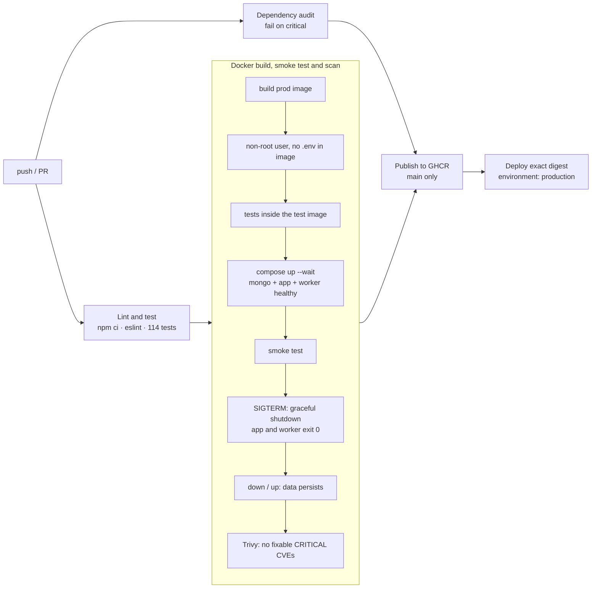
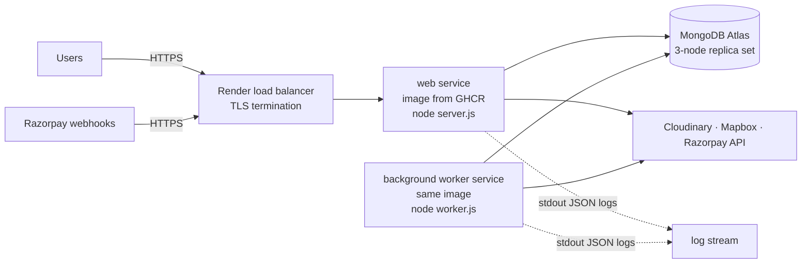

# Milestone 7: CI/CD pipeline and deployment plan

Goal: every change is linted, tested, built into the production image, started, smoke-tested and scanned automatically. Nothing reaches production unless all of that passed, and what gets deployed is the exact image that was tested.

> **✅ Status:** the pipeline runs on GitHub and is **green** on branch `milestone-7-ci-cd` ([run 39624260695](https://github.com/Mmeghna10/travel-by-chance/actions/runs/39624260695), on a runner with kernel 7.0). *Publish* and *Deploy* only run on `main`, so they haven't executed yet. The deploy target (Render + Atlas) hasn't been set up.

## 1. Pipeline (`.github/workflows/ci.yml`)

| Job | Runs on | What it proves |
|---|---|---|
| **Lint and test** | every push and PR | `npm ci` (exact lockfile versions; fails if `package.json` and the lockfile disagree) → ESLint → the full suite (real `mongod` replica set) |
| **Dependency audit** | every push and PR | no **critical** advisories in production dependencies (full report printed) |
| **Docker** | after tests pass | the production image builds; runs as user `node`; contains no `.env` or `.git`; the suite passes **inside** the test image; `docker compose up --wait` brings mongo, app and worker to *healthy*; the smoke test passes against the containers; `docker stop` triggers **graceful shutdown** (`SIGTERM received` → `Shutdown complete`, exit code 0) for app **and** worker; data survives `down`/`up`; Trivy finds no fixable CRITICAL CVEs |
| **Publish** | push to `main` only, after all of the above | image pushed to `ghcr.io/mmeghna10/travel-by-chance:sha-<commit>` (immutable) and `:main` |
| **Deploy** | after publish | calls the Render deploy hook with the **image digest** (`imgURL=…@sha256:…`), so exactly the tested bytes go live; skipped with a notice if the hook secret isn't configured |

The Docker job is also where the **open items from Milestones 1, 3 and 5 get closed**: graceful shutdown on SIGTERM (impossible to test on Windows) and the first real Docker run. Both are now closed: see §4.

### Design decisions
- **Gates:** `needs:` chains the jobs, so a failed test means no image is published, and no publish means no deploy.
- **Reproducible installs:** `npm ci`, the lockfile committed, the Node major pinned (22), and base images pinned to exact tags (Milestone 5).
- **Supply chain:** every third-party action is pinned to a **full commit SHA**, with the release in a comment. A tag like `@v7` can be moved to malicious code; a SHA can't.
- **Least privilege:** the workflow token is read-only; only the publish job gets `packages: write`.
- **Concurrency:** a newer push to the same branch cancels the older run.
- **Caching:** npm cache, the `mongod` test binary, and Docker layers (`type=gha`).
- **GHCR names must be lowercase**, and this repo's owner (`Mmeghna10`) isn't, so the image name is lowercased in the job (`${GITHUB_REPOSITORY,,}`). Tested locally: `ghcr.io/mmeghna10/travel-by-chance`.

### Lint (new in this milestone)
ESLint (flat config, `eslint:recommended`) with Node, browser and k6 environments. The first run found 13 issues, all fixed:
- `init/data.js` assigned to an **undeclared variable** (`module.exports = initData = …`), creating an accidental global. It would throw under strict mode.
- `public/js/payments.js` assigned a polling result it never used (the code said one thing and did another).
- An empty `catch`, now documented, and 10 unused imports and variables.

### Known audit findings (not failing the build)
`npm audit --omit=dev` reports 3 **high** findings, no critical:
- `cloudinary@1` (via `multer-storage-cloudinary@4`, which requires v1): argument injection through parameters containing `&`. We only pass fixed upload parameters. Fix: replace `multer-storage-cloudinary` with a direct `cloudinary@2` upload.
- `minimatch` via `ejs → jake`, a build tool that isn't used at runtime.

The gate is set at **critical** so the pipeline is usable today. Raise it to `high` once the Cloudinary migration is done.

## 2. Deployment plan

### Target architecture

- **Why Render?** It runs a Docker image as a web service *and* a background worker, terminates TLS, does rolling deploys gated on a health check, and has deploy hooks. Railway or Fly.io would work the same way with the same image. Kubernetes would be over-engineering for one app and one worker.
- **Why MongoDB Atlas, not the `mongo` container?** Backups, failover (a real 3-node replica set, which transactions need anyway), monitoring and upgrades. The Compose `mongo` service is for local development only.

### Environments
| Environment | Purpose | Database | Payments |
|---|---|---|---|
| local | development | Compose `mongo` or Atlas dev cluster | off, or Razorpay **test** |
| CI | every push; throwaway | in-memory / Compose, destroyed after | off |
| production | real users | Atlas production cluster | Razorpay test until KYC/activation, then live (`ALLOW_LIVE_PAYMENTS=true`) |

A **staging** service (same image, separate Atlas database, Razorpay test keys) is worth adding before taking real money: deploy there first, run `ci/smoke.js` against it, then promote the same digest.

### Configuration and secrets
Secrets live in the **platform's secret store** (Render environment variables) and in **GitHub environment secrets**, never in the repo or the image.

| Variable | Web | Worker | Production value / note |
|---|---|---|---|
| `NODE_ENV` | ✓ | ✓ | `production` |
| `ATLASDB_URL` | ✓ | ✓ | Atlas `mongodb+srv://` URI, with a dedicated DB user with least privileges |
| `SECRET` | ✓ | – | long random value; rotating it logs everyone out |
| `HTTPS_ONLY` | ✓ | – | `true` (Secure cookies) |
| `TRUST_PROXY` | ✓ | – | `1` (Render's proxy terminates TLS; needed for `req.secure` and real client IPs in rate limiting) |
| `RUN_BACKGROUND_JOBS` | `false` | – | jobs run in the worker service |
| `METRICS_TOKEN` | ✓ | ✓ | required anywhere public |
| `RAZORPAY_KEY_ID` / `_KEY_SECRET` / `_WEBHOOK_SECRET` | ✓ | ✓ | webhook URL `https://<domain>/api/v1/webhooks/razorpay` |
| `CLOUD_*`, `MAP_TOKEN` | ✓ | ✓ | |
| `LOG_LEVEL` | ✓ | ✓ | `info` |
| `DNS_SERVERS` | – | – | **unset** (only a local-network workaround) |

GitHub: in **Settings → Environments**, create `production` with **required reviewers** (manual approval before each deploy) and the secret `RENDER_DEPLOY_HOOK_URL`. In **Settings → Branches**, protect `main` and require the *Lint and test*, *Dependency audit* and *Docker* checks to pass before merging.

The GHCR package is private by default. Either make it public (the image contains no secrets) or give Render a registry credential (a token with `read:packages`).

### Database changes ("migrations")
MongoDB has no schema migrations, but there are still two kinds of change:
- **Indexes** are created at startup by `ensureIndexes()`. It's idempotent, and the server refuses traffic until the indexes the booking invariants depend on exist.
- **Data changes** are explicit, idempotent scripts (like `npm run migrate:bookings`, dry-run by default), run as one-off jobs, never automatically on boot.
- **Expand → migrate → contract:** first deploy code that understands both the old and new shape (expand), then run the data script, and only later deploy code that drops support for the old shape (contract). That's what makes rollback safe: the previous version still understands the data.

### Health checks and zero-downtime deploys
- Render health check path: **`/healthz`** (liveness). `/readyz` checks the database; if every instance failed it during a brief Atlas blip, the platform would restart all of them, which doesn't fix the database. `/readyz` is for load balancers and monitoring.
- Rolling deploy: the new instance must pass its health check before traffic moves. The old one gets SIGTERM, finishes in-flight requests (≤ 10 s, `server.js`) and exits. The CI Docker job tests exactly this shutdown path.

### Logs, metrics, alerts
- **Logs:** JSON on stdout (Milestone 6) → Render's log stream → forward to Grafana Loki, Datadog or similar. Search by `reqId`, `bookingId`, `level>=50`.
- **Metrics:** scrape `/metrics` (web) and `:9464/metrics` (worker; internal network) with `METRICS_TOKEN`, e.g. with a Grafana Cloud agent.
- **Alerts worth having from day one:** 5xx rate > 1 % for 5 min; booking p95 > 1 s; any `refund_outcomes_total{outcome="gave_up"}`; any `payment_outcomes_total{outcome="IGNORED_MISMATCH"}` or `DUPLICATE_CAPTURE`; `webhook_deliveries_total{result="invalid_signature"}` spike; background job errors.
- **Error tracking:** register a Sentry reporter with `addErrorReporter()` (Milestone 6 hook).

### Backups and restore
- Atlas dedicated tiers include continuous cloud backups with point-in-time restore. The free tier doesn't include them (check your tier), so schedule a `mongodump` to private storage.
- A backup that has never been restored is a hope, not a backup. Restore into a staging database once, and run the smoke test against it.

### Rollback
1. Find the last good commit's image: `ghcr.io/mmeghna10/travel-by-chance:sha-<commit>` (tags are immutable per commit).
2. Redeploy that image (Render dashboard: *Deploy a specific image*, or the deploy hook with `imgURL` set to that tag/digest).
3. Because database changes follow expand/contract, the previous version still works with the current data. If a data migration has to be undone, restore from backup (rehearsed above).

### Scaling path
Web instances are stateless (sessions in MongoDB, no local state), so they scale horizontally behind the load balancer. Two things change with more than one web instance:
- **Rate limiting** must move to a shared store (Redis), otherwise each instance counts separately.
- Background jobs already run safely in parallel (Milestones 3–4).

Milestone 6 measured that the **database** saturates first, so scale Atlas (and cut round trips per booking) before adding web instances.

## 3. Tested locally
| Check | Result |
|---|---|
| `ci.yml` against the official GitHub workflow JSON Schema (SchemaStore), with a broken copy as a negative control | valid; the broken copy produced the expected errors |
| Action versions | looked up via the GitHub API; each tag resolved to its commit SHA with `git ls-remote` |
| GHCR lowercasing (`${GITHUB_REPOSITORY,,}`) | `ghcr.io/mmeghna10/travel-by-chance` |
| `ci/smoke.js` against `node server.js` (production mode, real MongoDB) | all 9 checks pass; `--login` passes after a server restart against the same database |
| `npm run lint` | clean |
| `npm test` | 114 / 114 |
| `compose.yaml` still valid (worker health check changed in Milestone 6) | valid |

## 4. Results on GitHub Actions

Branch `milestone-7-ci-cd` was pushed to GitHub (not `main`). Every run, including the wrong turns:

| Run | Commit | Result | What happened |
|---|---|---|---|
| 39594296937 | `27050e4` | ❌ Docker job | Test image couldn't start `mongod`: missing `libcurl4` / `openssl` / `liblzma5` in `bookworm-slim`. Cleanup steps also failed because Compose needs `SECRET` |
| 39594886331 | `ceb2a7d` | ❌ Docker job | Tests passed inside the container; *Start the Compose stack* failed after 12 s. I found and fixed a real health-check bug and **assumed** it was the cause |
| 39595562847 | `be7e130` | ✅ all jobs | Green, which seemed to confirm the assumption. In hindsight it landed on an older-kernel runner |
| 39596250735 | `f7a8d25` (docs only) | ❌ Docker job | Same 12 s failure. I'd said this run "should pass" without checking it |
| 39598462731 | `c984390` (Milestone 8) | ❌ Docker job | Same failure. The new diagnostics annotation showed the real cause: `MongoDB cannot start: Linux kernel versions 6.19 and newer has a known incompatibility` (SERVER-121912) |
| 39622452167 | `d09dad4` | ❌ Docker job | Tried `mongo:8.3.13` on the assumption that newer 8.x was fixed. **Wrong**: it refuses too. The kernel annotation showed `7.0.0-1017-azure` |
| [39624260695](https://github.com/Mmeghna10/travel-by-chance/actions/runs/39624260695) | `1fe87aa` | ✅ all jobs | `mongo:7.0.45-jammy` on kernel `7.0.0-1017-azure`, the kernel that broke 8.x, so this run is proof. Docker job: build 17 s · tests in container 82 s · stack healthy 28 s · smoke 6 s · graceful shutdown · persistence 12 s · Trivy 11 s |

**Lessons:**
- **Diagnosing without logs.** GitHub only shows Actions logs to signed-in users and the API needs admin rights. The first cause was inferred from MongoDB's documented dependencies and confirmed when that step went green. For the rest, CI now **publishes container status, recent logs and the runner kernel as check annotations**, which the public API can read. That's what found the real cause.
- **One green run isn't proof when the failure is intermittent.** Run 39595562847 passed by luck (machine assignment). Proof came from a pass *on the kernel that had failed*, which is why CI now records the kernel.
- **"Newer" isn't the same as "fixed".** MongoDB 8.3.13 contains the same deliberate refusal as 8.0.34.

## 5. Production (verified after Milestone 8)
- **Publish:** runs on every merge to `main`. For example, merge `4572731` published `ghcr.io/mmeghna10/travel-by-chance:main` and `:sha-4572731…` (digest `sha256:9af05462…`). The package is public, so Render pulls it without credentials.
- **Live site:** https://travel-by-chance-main.onrender.com, a Render web service (free, Singapore) running that image.
  - **Database:** its own Atlas database `travelbychance`, separate from the development database, used through a dedicated user `tbc-prod` with `readWrite` on that database only.
  - **Data:** loaded with `create-admin` and the seed; map locations were filled in by `npm run fix:locations`.
- **Checked after deployment:**
  - `/healthz` and `/readyz` (`db: ok`).
  - All public pages, all 41 listings and the search API.
  - The booking box shows DEMO mode, never "test mode", and doesn't load Razorpay's script.
  - `http://` redirects 301 to `https://`; HSTS, CSP (with `upgrade-insecure-requests`), nosniff and frame-options headers are set.
  - `/metrics` returns 401 without the token; no cookie is set for anonymous visitors.
- **Free-tier trade-offs:**
  - There's no separate worker, so `RUN_BACKGROUND_JOBS` stays on in the web process.
  - The instance sleeps when idle, and jobs catch up when it wakes. Expiry compares `expiresAt`, so a late sweep is still correct.
  - Atlas free tier has no automatic backups.
- **Deploy hook:** the Deploy job skips with a notice until `RENDER_DEPLOY_HOOK_URL` is added to the GitHub `production` environment. Until then, Render redeploys from its dashboard.

## Files
- **New:** `.github/workflows/ci.yml`, `ci/smoke.js`, `eslint.config.js`, `docs/08-milestone-7-ci-cd.md`.
- **Changed:** `package.json` (`lint` script; dev: `eslint`, `@eslint/js`, `globals`), lint fixes in `init/data.js`, `controllers/listings.js`, `public/js/{map,payments}.js`, `routes/{listing,review,user}.js`, `test/{listings,payments}.test.js`; `README.md`.
