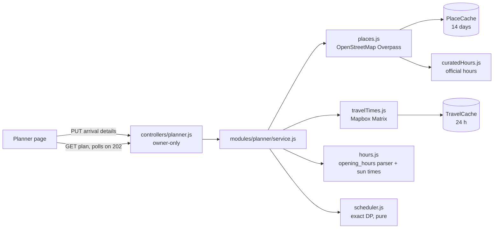

# 11. Arrival-day planner

**The problem:** a guest reaches the city at 7 am, but check-in is at 12 pm. They might go by cab, public transport, a rented vehicle, their own vehicle, or on foot. What can they see before check-in and after it, given:
- the distance between places,
- each place's opening and closing times, and
- how long renting a vehicle takes?

**The result:** on any active booking, **My Bookings → Plan my arrival day**. The guest enters:
- when they'll reach the hotel,
- how they'll get around,
- the rental pickup time, if renting,
- when they want to be back for the night.

They get a timeline, **before check-in** and **after check-in**. Each stop shows:
- travel time and distance,
- arrival time,
- visit window,
- closing time, and whether that time is confirmed,
- a Google Maps directions link.

Scope: stays in **India** (18 cities in the listings). Elsewhere the page says the planner isn't available yet.

---

## 1. Design



| Piece | Responsibility |
|---|---|
| `models/listing.js` | `checkInTime` ("HH:MM", default 12:00), set by the host in the listing form |
| `models/booking.js` | `arrival`: time, mode, rental minutes, end of day |
| `modules/planner/places.js` | Attractions within 10 km from **OpenStreetMap** (Overpass API): English names, notability score, duplicates within 150 m dropped. Cached in MongoDB for 14 days |
| `modules/planner/curatedHours.js` | Official opening hours for famous attractions. They override OpenStreetMap |
| `modules/planner/hours.js` | Parses OpenStreetMap `opening_hours` (`Sa-Th 06:00-18:30; Fr off`) with the reference parser. Resolves **sunrise/sunset** to that day's real local time |
| `modules/planner/travelTimes.js` | One **Mapbox Matrix** call gives travel times between every pair of points; cached 24 h. Falls back to a distance-based estimate |
| `modules/planner/modes.js` | Turns road time into door-to-door time for each travel mode |
| `modules/planner/scheduler.js` | **Pure** algorithm (below) |
| `modules/planner/service.js` | Glue: candidates, hours on the date, travel matrix, scheduler, view model, notes |

## 2. The algorithm

From the hotel, the planner visits the **most worthwhile set of places** in a time window:
- each visit must **finish before that place closes**;
- waiting for a place to open is allowed;
- the guest must be **back at the hotel by the end of the window**.

That is the *orienteering problem with time windows*, which is NP-hard in general. A window here considers at most 12 candidates, so it's solved **exactly** with dynamic programming over subsets:

```
best[visited set][last place] = earliest time we can finish seeing `last`,
                                having seen exactly `visited`
```

Keeping the *earliest finish* per state is safe: arriving earlier never hurts, because you can always wait. The search covers 2¹² sets × 12 last places × 12 next places, about 600k steps: a few milliseconds. The answer is the highest-scoring set that gets back in time; on a tie, the one that returns earliest.

**No waiting outside:** if the first place isn't open yet when the window starts (say, a 6:30 am arrival and a 9 am opening), the plan tells the guest to rest at the hotel and leave so they arrive at opening time. This was found on live Jaipur data: the first version had a guest wait 1 h 45 min outside Hawa Mahal.

**Proof it's exact, not a heuristic:** a test compares it with brute force (every order of every subset) on **300 random instances**. It also checks that every returned visit fits its opening hours and that the route returns in time. A second test shows a case where "nearest place first" is worse, and the planner isn't.

**The day as two windows:**

| Window | Starts | Ends | Travel mode |
|---|---|---|---|
| **Before check-in** (only if they arrive early) | arrival + 15 min to drop luggage | check-in time, back at the hotel | the chosen mode, except **cab for renters**, who don't have the vehicle yet |
| **After check-in** | max(arrival, check-in) + 30 min, + the rental pickup time if renting | when they want to be back | the chosen mode |

Places seen in the morning aren't repeated.

**Travel modes** (`modes.js`):

| Mode | Door-to-door time |
|---|---|
| cab | driving time + ~10 min waiting for the cab |
| own vehicle / rental | driving time + ~5 min parking |
| walking | Mapbox walking time |
| **public transport** | an **estimate**: 1.8× driving time + 15 min. Mapbox has no transit routing for these cities, and the plan says so |

## 3. Data sources, and what was measured before choosing

**Places: OpenStreetMap (live).** Measured on the real Overpass API:

| City | Named attractions within 6 km | With opening hours | Famous places with hours |
|---|---|---|---|
| Agra | 33 | **3 (9%)** | Taj Mahal: **none** |
| Jaipur | 35 | **6 (17%)** | Hawa Mahal only |

The public Overpass servers took **40–73 s** per query, and one returned a **502**. That's why:
- results are cached in MongoDB for 14 days, shared by all instances and surviving restarts and the free tier's sleep;
- a second server is tried if the first one fails;
- the guest's request **never waits**: the first request for an area returns **202**, the fetch runs in the background, and the page polls. The real Agra fetch took 38 s.

**Opening hours: curated list + OpenStreetMap + labelled defaults.** Because OpenStreetMap rarely has hours, famous attractions get hours from **official sources only** (`curatedHours.js`; each entry records its source). The rules:
- **Official sources often disagree.** Jantar Mantar Jaipur is listed as closing at 4:30 pm on one government page and 7 pm on another, and Amber Fort has three different timings. The **narrowest window** is used, so the planner never sends someone when a place might be shut.
- **Unconfirmed places are left out.** For example, the Red Fort's closed day couldn't be confirmed from an official page, so it isn't in the list.
- **Every other place without hours** is scheduled within **typical hours (9 am–6 pm)** and marked "not published, check before going".
- **Sun times are computed, not hard-coded.** The Taj Mahal opens 30 minutes before sunrise and closes 30 minutes before sunset (tajmahal.gov.in). The parser would compute sun times in the *server's* time zone, which is wrong on a UTC server, so sunrise and sunset are resolved with `suncalc` for that date and place, in IST, before parsing.

**Travel times: Mapbox Matrix API** (the existing `MAP_TOKEN`). One call returns the time between every pair of up to 16 points (hotel + 15 candidates = 256 elements). Mapbox bills per element, so results are cached for 24 h. If Mapbox fails, distance-based estimates are used (×1.35 road factor, 25 km/h by car, 4.5 km/h walking), and the plan says so.

## 4. API

| Method | Path | Auth | Result |
|---|---|---|---|
| GET | `/bookings/:id/plan` | owner | The planner page |
| PUT | `/api/v1/bookings/:id/arrival` | owner | Save `{ arrivalTime, mode, rentalMinutes?, dayEndsAt? }`. Errors: `400 INVALID_ARRIVAL`, `409 BOOKING_NOT_ACTIVE` |
| GET | `/api/v1/bookings/:id/arrival-plan` | owner | `200` plan · `202` places still being fetched · `409 ARRIVAL_DETAILS_MISSING` · `422 PLANNER_UNAVAILABLE` (outside India / no map location) · `503 PLACES_UNAVAILABLE` |

Someone else's booking gets `404`, as everywhere else. Place names are untrusted text from OpenStreetMap, so the page builds the timeline with `textContent`, never `innerHTML`.

## 5. Verification

- **`test/unit/planner.test.js` (14):**
  - time helpers; opening hours (closed day, lunch break, 24/7, unknown hours flagged);
  - sun times resolved in IST;
  - travel modes; visit must fit one open interval;
  - early arrival; closing time to the minute; Taj Mahal on a Friday; rental; late arrival; arrival after the day ends;
  - best route vs nearest-first; **brute-force equivalence on 300 random instances**;
  - curated hours only apply in their own city, with no partial-name matches.
- **`test/planner.test.js` (10), real database, fake OpenStreetMap and Mapbox:**
  - OpenStreetMap normalisation (English names, duplicates, curated hours);
  - full API flow including the 202 → plan polling;
  - Friday excludes the Taj; rental and walking;
  - places and travel times fetched **once**, then cached;
  - Mapbox down → estimates plus a note; OpenStreetMap down → a clear `503`;
  - owner-only access, validation, inactive and non-India bookings;
  - page and My Bookings button; host check-in time.
- **Real data, Agra:**
  - **Thursday, arriving 7 am by cab:** Agra Fort → I'timād-ud-Daulah → back 11:33 am; check in 12:00; Taj Mahal 1:00–3:00 pm (closes 5:02 pm that day) → Mariam's Tomb → Akbar's Tomb.
  - **Friday:** the Taj Mahal is correctly absent.
  - **With a 45-minute rental:** the afternoon starts at 1:15 pm.
- **Browser (local site):** booking → My Bookings → Plan my arrival day → rented vehicle → the timeline renders, with no console errors.

## 6. Limitations and next steps

- **Coverage:** India only, because of one time zone. Other countries need the hotel's time zone, which is a small change once listings store it.
- **Hours:** most attractions have no published hours on OpenStreetMap. The curated list covers 20 places in 10 cities and should grow, one official source at a time. One of them, Kolkata's Indian Museum, is marked closed, because its own site says its galleries are closed during 2026.
- **Hotel location:** hosts can add a street address; then the pin and the planner use the building. Listings without one use the city centre, and the plan says the first and last legs are approximate.
- **Scoring:** places are scored by kind and notability (Wikidata/Wikipedia tags). Ratings or the guest's interests (temples, museums, nature) would personalise it.
- **Splitting the day:** the morning is planned first, then the afternoon. Planning both together could occasionally do slightly better.
- **Public transport:** times are estimates. A transit-routing API would replace them.
